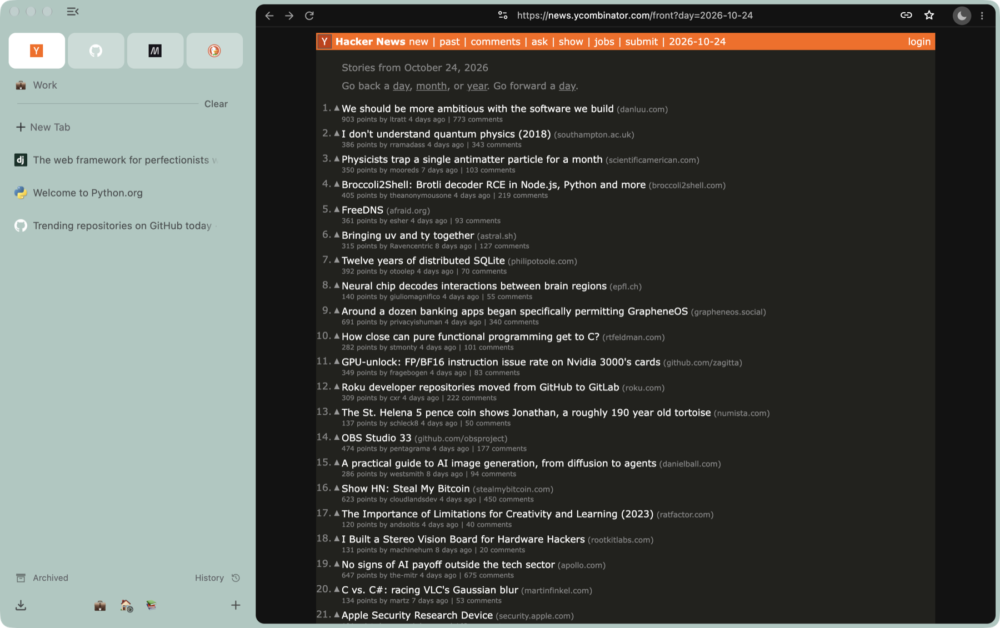
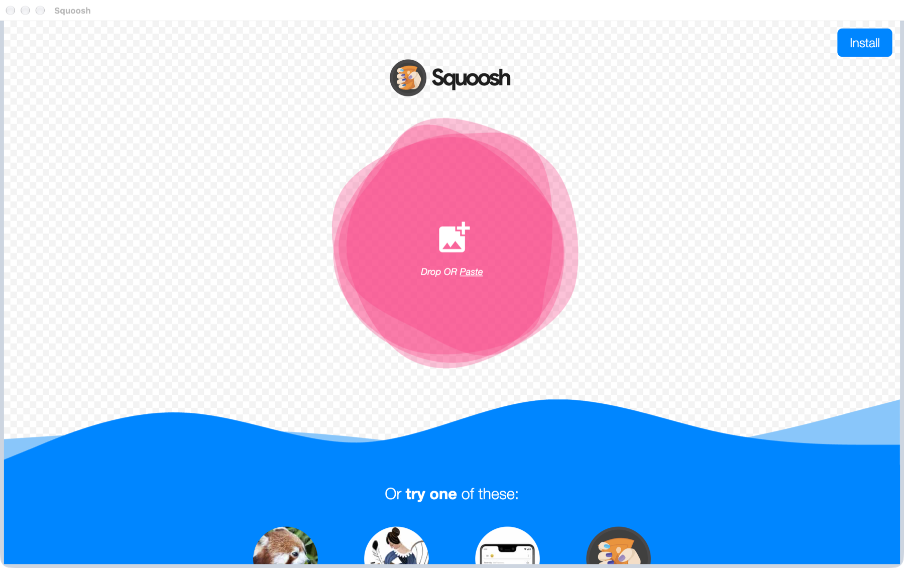
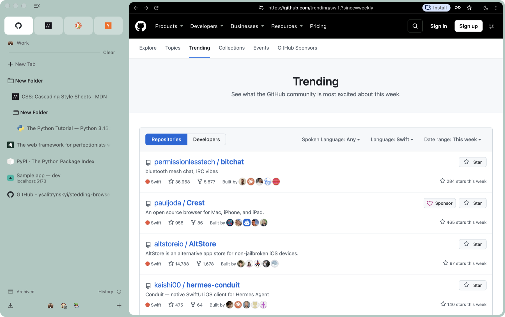

<picture>
  <source media="(prefers-color-scheme: dark)" srcset="branding/public/svg/logo-horizontal-dark.svg">
  
</picture>

# Stedding Browser

**Arc's way of browsing, open source, on Chromium.** Tabs in a sidebar, Spaces, pinned tabs
and folders, and one command bar for everything. macOS (Apple silicon) and Windows. No
account, no telemetry, BSD-3-Clause.

[](https://github.com/ysalitrynskyi/stedding-browser/releases)
[](LICENSE)


[stedding.dev](https://stedding.dev) · [Download](#download) · [Shortcuts](docs/SHORTCUTS.md) ·
[FAQ](docs/FAQ.md) · [Privacy](docs/PRIVACY.md) · [Build](#building-from-source)


**[Download for macOS](https://github.com/ysalitrynskyi/stedding-browser/releases/latest)** ·
Apple silicon, macOS 13 or later, signed with the project's Developer ID and notarized by Apple<br>
**[Download for Windows](https://github.com/ysalitrynskyi/stedding-browser/releases/latest)** ·
Windows 10 and 11, x64, installs for you alone<br>
Homebrew: `brew install --cask ysalitrynskyi/stedding/stedding` · [Install guide](docs/INSTALL.md)

## Highlights

<table>
  <tr>
    <td width="50%"><br>
      <b>Folders in the pinned tabs.</b> Drag one over the line, to any place among the pins; a bar shows where it will land.</td>
    <td width="50%"><br>
      <b>Spaces with the mouse.</b> Scroll sideways over the sidebar, with a tilt wheel or Shift and the wheel: one Space for each notch. On Windows, Ctrl and the wheel does it too.</td>
  </tr>
  <tr>
    <td><br>
      <b>Little windows, then a tab.</b> A link from another app opens small, its row in the page's colour; <b>Open in Stedding</b> (⌘O, Ctrl+O) moves it into a tab.</td>
    <td><br>
      <b>⌘W (Ctrl+W) on a pinned tab</b>, as in Arc: it goes back to its pinned page, asleep, in its place.</td>
  </tr>
</table>

Each release's notes are on the
[Releases page](https://github.com/ysalitrynskyi/stedding-browser/releases).

## What Arc never had

1. **Open source, with no account.** Stedding is BSD-licensed and asks you to sign up for
   nothing: download it and use it. Arc requires an account, and its code is closed.
2. **Spaces with their own sign-ins, in one profile.** Give a Space an Independent session and
   it keeps its own cookies and site data, so the same site can be signed in as work in one
   Space and as you in another. Extensions, settings, history and saved passwords stay shared.
   Arc keeps sign-ins apart only by giving a Space a whole separate profile.
   [Spec](docs/features/sessions.md)
3. **Dark pages.** One switch draws every website dark from its first frame: the moon by the
   address row, or ⌥⇧⌘D (Ctrl+Alt+Shift+D). Keep some sites light, or darken only the ones you
   list. [Spec](docs/features/dark-pages.md)
4. **Apps from any page.** Add to Dock… on the Mac, Install page as app… on Windows: the page
   gets a window and an icon of its own and keeps the session of the Space it was made in, so
   it stays signed in as that Space is. Arc does not install web apps.
   [Spec](docs/features/web-apps.md)
5. **Site cleanup in one step.** Clear Site Cookies and Reload (⌥⇧⌘R, Ctrl+Alt+Shift+R) signs
   you out of the site in front of you and nothing else; Close Duplicate Tabs is one command
   away. [Spec](docs/features/commandbar.md)
6. **Your sidebar on every computer.** Pick any folder your computers share (iCloud, Dropbox,
   Syncthing and more). Each Stedding keeps its Spaces, pins, pinned folders and essentials there, and
   makes no network request of its own. [Spec](docs/features/sidebar-file.md)
7. **Links without trackers, and blocking if you want it.** `utm_` and similar parameters
   come off the links you open; ad and tracker blocking is built in, off until you turn it
   on. [Spec](docs/features/clean-links.md), [Spec](docs/features/blocker.md)

<p>
  
  
</p>

## Everything you know from Arc

- **The sidebar**: vertical tabs, essentials as cards, pinned tabs that remember their page,
  nested folders (in the pinned tabs too), and ⌘S (Ctrl+S) to fold it to a rail of icons or
  hide it. ⌘W (Ctrl+W) on a pinned tab sends it back to its page, asleep, in its place. While it is awake the close button is a minus that does the same, on screen or not. Once it is asleep the button is an x that asks before it removes the pin.
- **Spaces** with their own colour and icon: switch with the chips, ⌃1–⌃9 (Alt+1–Alt+9), a
  two-finger swipe, or the mouse's sideways scroll over the sidebar. A Space can keep its own
  cookies, so one site can be signed into twice.
- **⌘T (Ctrl+T)**: a URL, a search, or an open or archived tab in any Space. ⇧⌘P
  (Ctrl+Shift+P) lists the commands, each with its key.
- **Split view**: drag a tab onto the page, and it opens beside it.
- **Peek**: a link from a pinned tab that leaves its site opens over the window; keep it as a
  tab or beside the pin. On a click, or only on a held press, as you choose.
- **History and Downloads in the sidebar**, the sidebar on the left or the right, and
  **shortcuts you can change**.
- **Little windows** for links from other apps, with **Open in Stedding** to keep the page as
  a tab; sites **routed** to their Space, **sleeping tabs**, and an **archive** for idle tabs,
  off until you choose.
- **Local development tabs** wear a yellow and black dashed outline while on screen. At Comfortable density every local tab with a title shows its host and port.
- **Copy the link** clean of trackers (⇧⌘C, Ctrl+Shift+C) or as Markdown, **screenshots** by
  key, mute and picture in picture by key.
- **Arc in one click**: Spaces, essentials, pins, folders, tabs, history and passwords, on the
  Mac and on Windows.
- **Arc's keyboard** on both platforms, and **updates** in the sidebar. The feed and the
  download are checked against a signature. Stedding looks when you open it if the last look
  was over an hour ago, and every six hours while it runs. A switch turns that off.

Each feature has a specification naming the test behind every behaviour:
[docs/features/](docs/features/).

## What Arc has that Stedding does not

- **Boosts and Easels**: deferred ([ADR 0012](docs/decisions/0012-defer-boosts-and-easels.md)).
- **The mini player** in the sidebar: planned; picture in picture by key until then (`S-95`).
- **The Library panel and Live Folders**: later (`S-61`).
- **Shared Spaces and share links**: there is no account or server, by design. Your own
  computers keep the sidebar in step through a folder you choose; to give a Space to someone,
  send it as a file.
- **AI (Arc Max)**: never, by choice ([ADR 0020](docs/decisions/0020-no-bundled-model.md)).
- **Phones** (Arc Search): desktop only.

## Download

From [stedding.dev](https://stedding.dev/#download) or the
[Releases page](https://github.com/ysalitrynskyi/stedding-browser/releases). The newest release
is **0.4.0 beta 2**, for macOS and Windows, on Chromium 157.0.8103.31.

| Platform | File | |
|---|---|---|
| macOS 13 or later, Apple silicon | `Stedding-<version>-arm64.dmg` | Signed with the project's Developer ID and notarized by Apple. Drag it to Applications and open it |
| Windows 10 / 11, x64 | `Stedding-<version>-win-x64.exe` | Installs for you alone, with no administrator prompt. Not signed yet: SmartScreen → **More info** → **Run anyway**, once |

On a Mac, Homebrew installs it too:

```bash
brew install --cask ysalitrynskyi/stedding/stedding
```

After that it updates itself (the Mac from 0.2.0 beta 16, Windows from 0.2.0 beta 19; an older
Windows copy needs one install by hand). Checksums are in each release's notes;
[docs/INSTALL.md](docs/INSTALL.md) covers verifying, updating and uninstalling. Intel Macs are
not supported. Linux is not shipped.

<picture>
  <source media="(prefers-color-scheme: dark)" srcset="docs/images/readme/hero-dark.png">
  
</picture>

## Keyboard shortcuts

The ones you will use most. These are the keys it ships with. Settings → Stedding → Shortcuts
can change them, and **Number keys for the rows and the Spaces** can put Spaces on ⌘1–⌘9
(Ctrl+1–Ctrl+9) or on ⌃⌘1–⌃⌘9 (Alt+Shift+1–Alt+Shift+9). The full list is
[docs/SHORTCUTS.md](docs/SHORTCUTS.md).

| Action | macOS | Windows |
|---|---|---|
| Command bar: search, a URL, any tab | ⌘T | Ctrl+T |
| Every command, with its key | ⇧⌘P | Ctrl+Shift+P |
| Fold or show the sidebar | ⌘S | Ctrl+S |
| Pin the tab in its Space | ⌘D | Ctrl+D |
| Space 1–9 / next / previous | ⌃1–⌃9 / ⌥⌘→ / ⌥⌘← | Alt+1–Alt+9 / Ctrl+Alt+→ / Ctrl+Alt+← |
| Most recent tab in this Space | ⌃⇥ | Ctrl+Tab |
| Clear the Space's loose tabs | ⇧⌘K | Ctrl+Shift+K |
| Split the tab with a new one | ⌃⌘N | Alt+Shift+N |
| Dark pages on or off | ⌥⇧⌘D | Ctrl+Alt+Shift+D |
| Copy the link, clean | ⇧⌘C | Ctrl+Shift+C |

## Moving from Arc

With Arc installed, the first start offers **Move everything from Arc**: Spaces with their
colours and icons, essentials, pinned tabs, nested folders, open tabs, history and passwords.
It reads Arc's files on your disk and sends nothing anywhere. On a Mac the passwords need one
keychain prompt; on Windows none. Running it again does not duplicate anything.

The same welcome step brings bookmarks, history and passwords from Dia (on a Mac, Dia's
passwords need one keychain prompt), and from the file Safari exports. Passwords in that file
are plain text, so they stay unticked until you ask for them. Chromium's own importer also
lists the browsers it finds, including Firefox, and on the Mac Safari's bookmarks.

## Privacy

- **No telemetry, no experiments, no account.** No usage metrics, crash reports or
  identifiers. The new tab page makes no requests.
- **Protective defaults**: third-party cookies blocked, HTTPS-First, Global Privacy Control,
  quiet prompts for notifications and location, search suggestions off, DuckDuckGo until you
  choose an engine.
- **No Google sign-in, and no AI sections in Settings.**
- **Safe Browsing is not active yet.** Its lists need a Google API key the builds do not
  carry (`S-75`). The local warnings for dangerous file types still work.

The connections the browser makes are listed in [docs/PRIVACY.md](docs/PRIVACY.md). Anything
else is a bug.

## It is Chromium

Chromium stable, with a documented series of patches, so sites, extensions and DevTools
behave as they do in Chrome.

| Part | In Stedding | |
|---|---|---|
| Engine | Chromium 157, stable channel | ✓ |
| Chrome extensions | From the Chrome Web Store, as in Chrome | ✓ |
| H.264 and AAC | The video and audio codecs plain Chromium leaves out | ✓ |
| DevTools | Chromium's own | ✓ |
| Google services | No sign-in, sync, telemetry or experiments. Chromium's component updates and network time stay ([PRIVACY.md](docs/PRIVACY.md)) | ✓ |
| Ad and tracker blocking | Built in, from EasyList and EasyPrivacy; off until you turn it on | ✓ |
| Sync | Your sidebar, through a folder your own sync app keeps; no account | Your folder |
| Import | Arc (Mac and Windows), Dia, Safari's export file, Firefox. Chrome, Brave, the new Edge, Vivaldi and Chromium are not offered | Most |
| Updates | Checked against a signature, in the background, with a switch to turn them off | ✓ |
| Safe Browsing | Waits on a Google API key (`S-75`) | Not yet |
| Netflix, Disney+, Prime Video, Spotify | Need Widevine, which needs a licence from Google first (`S-270`) | Not yet |
| Windows code signing | SmartScreen asks once (`S-56`) | Not yet |
| Intel Macs | Apple silicon only | Not supported |
| Linux | After Windows ([ROADMAP](docs/ROADMAP.md), M9) | Not yet |

To hear when a release is out, use **Watch → Custom → Releases** at the top of this page.

## Status

A beta. On a Mac with a second desktop, Mission Control takes ⌃1–⌃9 before Stedding does.
The Spaces menu still has them, and Settings → Stedding → Shortcuts can move the Space keys
to ⌘1–⌘9 or ⌃⌘1–⌃⌘9. While Arc runs it takes ⌥⌘N from every app; split with ⌃⌘N (`S-79`;
[the FAQ](docs/FAQ.md) has the way round). Open work is in [BACKLOG.md](BACKLOG.md), the
milestones in [docs/ROADMAP.md](docs/ROADMAP.md), and every release's notes on the
[Releases page](https://github.com/ysalitrynskyi/stedding-browser/releases).

## Building from source

Stedding is a documented patch series on Chromium stable. `tooling/sync-chromium` will not
start below 150 GB free. The first build takes a few hours.

On a Mac (Apple silicon):

```bash
tooling/bootstrap-depot-tools     # once per machine
tooling/sync-chromium             # once per pin change; tens of GB
tooling/apply-patches             # the Stedding patch series
tooling/apply-branding            # the name and the icon
tooling/build-chromium release --budget 0
tooling/package-dmg release       # unsigned, unless you sign it
```

On Windows the checkout uses the same `tooling/sync-chromium`, `tooling/apply-patches` and
`tooling/apply-branding` (Git for Windows for those shell scripts). Then:

```powershell
tooling\win\build.ps1 -BudgetMinutes 0
tooling\win\package-installer.ps1
```

`build.ps1` stops after 15 minutes if you leave the budget unset. Prerequisites:
[docs/ARCHITECTURE.md](docs/ARCHITECTURE.md).

## Contributing

The most useful thing now is a report from real use: install the latest beta, use it for a
day, and open an issue for each thing that is worse than what you use today. See
[CONTRIBUTING.md](CONTRIBUTING.md). Security issues go through private reporting
([SECURITY.md](SECURITY.md)). A pull request made with an AI tool's help says so, and each of
its commits carries an `Assisted-by:` trailer
([CONTRIBUTING.md, "AI tools"](CONTRIBUTING.md#ai-tools)). New contributors start at
[AGENTS.md](AGENTS.md). The index of every document is [docs/README.md](docs/README.md).

## License

[BSD-3-Clause](LICENSE). Chromium is © The Chromium Authors, BSD-3-Clause.

Stedding is offered as is, without warranty. Its authors and contributors are not liable for
what comes of using it. The [licence](LICENSE) has the exact words.
