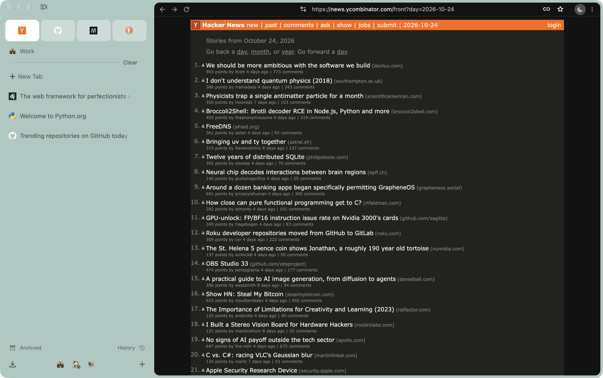
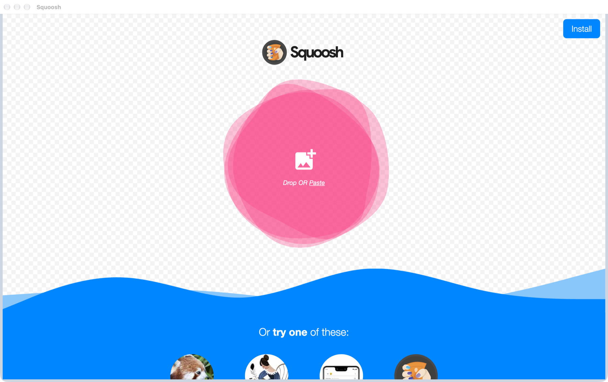

<picture>
  <source media="(prefers-color-scheme: dark)" srcset="branding/public/svg/logo-horizontal-dark.svg">
  
</picture>

# Stedding Browser

**Arc's way of browsing, open source, on Chromium.** Tabs in a sidebar, Spaces, pinned tabs
and folders, and one command bar for everything. macOS (Apple silicon) and Windows. No
account, no telemetry, BSD-3-Clause.

[](https://github.com/ysalitrynskyi/stedding-browser/releases)
[](LICENSE)


[stedding.dev](https://stedding.dev) · [Download](#download) · [Shortcuts](docs/SHORTCUTS.md) ·
[FAQ](docs/FAQ.md) · [Privacy](docs/PRIVACY.md) · [Build](#building-from-source)

<picture>
  <source media="(prefers-color-scheme: dark)" srcset="docs/images/readme/demo-dark.webp">
  
</picture>

**[Download for macOS](https://github.com/ysalitrynskyi/stedding-browser/releases/latest)** ·
Apple silicon, macOS 13 or later, signed with the project's Developer ID and notarized by Apple<br>
**[Download for Windows](https://github.com/ysalitrynskyi/stedding-browser/releases/latest)** ·
Windows 10 and 11, x64, installs for you alone<br>
Homebrew: `brew install --cask ysalitrynskyi/stedding/stedding` · [Install guide](docs/INSTALL.md)

## What Arc never had

| Feature | What it does |
|---|---|
| **Open source, no account** | BSD-licensed. Download it and use it. Arc needs an account, and its code is closed |
| **[Two sign-ins, one profile](docs/features/sessions.md)** | A Space can keep its own cookies, so one site can be signed in as work here and as you there. Extensions, history and passwords stay shared |
| **[Dark pages](docs/features/dark-pages.md)** | One switch draws every website dark from its first frame: the moon by the address row, or ⌥⇧⌘D (Ctrl+Alt+Shift+D) |
| **[Apps from any page](docs/features/web-apps.md)** | A page gets a window and an icon of its own, and stays signed in as its Space is |
| **[Your sidebar on every computer](docs/features/sidebar-file.md)** | Through a folder you already sync, or WebDAV or S3 storage you have. There is no Stedding server |
| **[Site cleanup](docs/features/commandbar.md)** | ⌥⇧⌘R (Ctrl+Alt+Shift+R) signs you out of the site in front of you and nothing else. Close Duplicate Tabs is one command away |
| **[Clean links](docs/features/clean-links.md) and [blocking](docs/features/blocker.md)** | `utm_` and similar come off the links you open. Ad and tracker blocking is built in, off until you turn it on |

<p>
  
  
</p>

## Moving from Arc

The Browser Company says Arc stops working on December 22, 2026. With Arc installed, the first
start offers **Move everything from Arc**: Spaces, essentials, pinned tabs, folders, open tabs,
history and passwords, on the Mac and on Windows. It reads Arc's files on your disk and sends
nothing anywhere. Running it again duplicates nothing.

Everything is where you expect it, sometimes under another name:

| In Arc | In Stedding | Where |
|---|---|---|
| Favorites | Essentials | Cards at the top of the sidebar |
| Pinned tabs and folders | The same | Folders nest, among the pins too |
| Spaces | Spaces | ⌃1–⌃9 (Alt+1–Alt+9), a two-finger swipe, or the chips |
| Command bar | Command bar | ⌘T (Ctrl+T). ⇧⌘P (Ctrl+Shift+P) lists every command |
| Split view | Split view | Drag a tab onto the page |
| Peek | Peek | A pinned tab's link to another site opens over the page |
| Little Arc | Little windows | Links from other apps. ⌘O keeps one as a tab |
| Air Traffic Control | Routes | Settings → Stedding → Sites routed to Spaces, or **Route sites here…** on a Space's menu |
| A profile for a Space | Independent session | Right-click a Space. Its sign-ins stay apart, in one profile |
| Auto-archive | The archive | Off until you turn it on |
| Hidden sidebar | Folding sidebar | ⌘S (Ctrl+S) |
| Sync | Sidebar sync | Settings → Stedding → Sync and import |

<details open>
<summary><b>Questions people ask when they move</b></summary>

**Can several Spaces use the same profile?** Yes, that is how it starts: every Space shares one
profile until you give it an Independent session. Several Spaces sharing one separate session is
built and not released yet (`S-272`).

**Can one Space hold tabs from different profiles?** No, and it is not planned. A Space has one
session. Arc did not do this either.

**Why does Netflix not play, and is there a Safari mode?** Netflix, Disney+, Prime Video and
Spotify's web player need Widevine, and that takes a licence from Google (`S-270`). Until then
these sites show a notice with a button that opens the page in Safari or Edge. There is no Safari
mode: Stedding is Chromium changed directly, with no wrapper around another engine.

More in [the FAQ](docs/FAQ.md).

</details>

<details>
<summary><b>Everything else you know from Arc</b></summary>

- **The sidebar**: ⌘W (Ctrl+W) on a pinned tab sends it back to its page, asleep, in its place.
  It folds to a rail of icons, sits on the left or the right, and holds History and Downloads.
- **Spaces**: a colour and an icon each, or one colour for light and another for dark. The
  mouse's sideways scroll over the sidebar switches them too.
- **The address** on top, or in the sidebar with Back, Forward and Reload. The button at the
  field's start opens the site panel.
- **Peek** on a click, or only on a held press, on a card or in a small window.
- **Sleeping tabs**, **shortcuts you can change**, and **updates** in the sidebar, checked
  against a signature. A switch turns them off.
- **Local development tabs** wear a yellow and black dashed outline.
- **Copy the link** clean of trackers (⇧⌘C, Ctrl+Shift+C) or as Markdown, and **screenshots**,
  mute and picture in picture by key.

Each feature has a specification naming the test behind every behaviour:
[docs/features/](docs/features/).

</details>

<details>
<summary><b>Moving from another browser</b></summary>

The same welcome step brings bookmarks, history and passwords from Chrome, Edge, Brave, Vivaldi,
Opera and Dia (on a Mac, each browser's passwords need one keychain prompt; on Windows, passwords
that Chrome seals with its own key cannot be read and are counted), and from the file Safari
exports. Settings → Stedding → Sync and import → **Import from another browser** opens that step
again any time. Passwords in that file are plain text, so they stay unticked until you ask for
them. Chromium's own importer also lists the browsers it finds, including Firefox, and on the Mac
Safari's bookmarks.

</details>

## What Arc has that Stedding does not

| In Arc | Here |
|---|---|
| Boosts and Easels | Deferred ([ADR 0012](docs/decisions/0012-defer-boosts-and-easels.md)) |
| The mini player in the sidebar | Planned (`S-95`). Picture in picture by key until then |
| The Library panel and Live Folders | Later (`S-61`) |
| Shared Spaces and share links | No account or server, by design. Send a Space as a file |
| AI (Arc Max) | Never, by choice ([ADR 0020](docs/decisions/0020-no-bundled-model.md)) |
| Phones (Arc Search) | Desktop only |

## Download

From [stedding.dev](https://stedding.dev/#download) or the
[Releases page](https://github.com/ysalitrynskyi/stedding-browser/releases). The newest release
is **0.5.0**, for macOS and Windows, on Chromium 157.0.8103.79.

| Platform | File | |
|---|---|---|
| macOS 13 or later, Apple silicon | `Stedding-<version>-arm64.dmg` | Signed with the project's Developer ID and notarized by Apple. Drag it to Applications and open it |
| Windows 10 / 11, x64 | `Stedding-<version>-win-x64.exe` | Installs for you alone, with no administrator prompt. Not signed yet: SmartScreen → **More info** → **Run anyway**, once |

On a Mac, Homebrew installs it too:

```bash
brew install --cask ysalitrynskyi/stedding/stedding
```

After that it updates itself (the Mac from 0.2.0 beta 16, Windows from 0.2.0 beta 19; an older
Windows copy needs one install by hand). Checksums are in each release's notes;
[docs/INSTALL.md](docs/INSTALL.md) covers verifying, updating and uninstalling. Intel Macs are
not supported. Linux is not shipped.

## Keyboard shortcuts

The ones you will use most. These are the keys it ships with. Settings → Stedding → Shortcuts
can change them, and **Number keys for the rows and the Spaces** can put Spaces on ⌘1–⌘9
(Ctrl+1–Ctrl+9) or on ⌃⌘1–⌃⌘9 (Alt+Shift+1–Alt+Shift+9). The full list is
[docs/SHORTCUTS.md](docs/SHORTCUTS.md).

| Action | macOS | Windows |
|---|---|---|
| Command bar: search, a URL, any tab | ⌘T | Ctrl+T |
| Every command, with its key | ⇧⌘P | Ctrl+Shift+P |
| Fold or show the sidebar | ⌘S | Ctrl+S |
| Pin the tab in its Space | ⌘D | Ctrl+D |
| Space 1–9 / next / previous | ⌃1–⌃9 / ⌥⌘→ / ⌥⌘← | Alt+1–Alt+9 / Ctrl+Alt+→ / Ctrl+Alt+← |
| Most recent tab in this Space | ⌃⇥ | Ctrl+Tab |
| Clear the Space's loose tabs | ⇧⌘K | Ctrl+Shift+K |
| Split the tab with a new one | ⌃⌘N | Alt+Shift+N |
| Dark pages on or off | ⌥⇧⌘D | Ctrl+Alt+Shift+D |
| Copy the link, clean | ⇧⌘C | Ctrl+Shift+C |

## Privacy

- **No telemetry, no experiments, no account.** No usage metrics, crash reports or
  identifiers. The new tab page makes no requests.
- **Protective defaults**: third-party cookies blocked, HTTPS-First, Global Privacy Control,
  quiet prompts for notifications and location, search suggestions off, DuckDuckGo until you
  choose an engine.
- **No Google sign-in, and no AI sections in Settings.**
- **Safe Browsing is not active yet.** Its lists need a Google API key the builds do not
  carry (`S-75`). The local warnings for dangerous file types still work.

The connections the browser makes are listed in [docs/PRIVACY.md](docs/PRIVACY.md). Anything
else is a bug.

## It is Chromium

Chromium stable, with a documented series of patches, so sites, extensions and DevTools
behave as they do in Chrome.

<details>
<summary><b>What is in, and what is not yet</b></summary>

| Part | In Stedding | |
|---|---|---|
| Engine | Chromium 157, stable channel | ✓ |
| Chrome extensions | From the Chrome Web Store, as in Chrome | ✓ |
| H.264 and AAC | The video and audio codecs plain Chromium leaves out | ✓ |
| DevTools | Chromium's own | ✓ |
| Google services | No sign-in, sync, telemetry or experiments. Chromium's component updates and network time stay ([PRIVACY.md](docs/PRIVACY.md)) | ✓ |
| Ad and tracker blocking | Built in, from EasyList and EasyPrivacy; off until you turn it on | ✓ |
| Sync | Your sidebar, through a folder your own sync app keeps, or WebDAV or S3 storage you set up; no account | Your folder or storage |
| Import | Arc (Mac and Windows), Chrome, Edge, Brave, Vivaldi, Opera, Dia, Safari's export file, Firefox | Most |
| Updates | Checked against a signature, in the background, with a switch to turn them off | ✓ |
| Safe Browsing | Waits on a Google API key (`S-75`) | Not yet |
| Netflix, Disney+, Prime Video, Spotify | Need Widevine, which needs a licence from Google first (`S-270`) | Not yet |
| Windows code signing | SmartScreen asks once (`S-56`) | Not yet |
| Intel Macs | Apple silicon only | Not supported |
| Linux | After Windows ([ROADMAP](docs/ROADMAP.md), M9) | Not yet |

</details>

To hear when a release is out, use **Watch → Custom → Releases** at the top of this page.

## Status

A beta. On a Mac with a second desktop, Mission Control takes ⌃1–⌃9 before Stedding does.
The Spaces menu still has them, and Settings → Stedding → Shortcuts can move the Space keys
to ⌘1–⌘9 or ⌃⌘1–⌃⌘9. While Arc runs it takes ⌥⌘N from every app; split with ⌃⌘N (`S-79`;
[the FAQ](docs/FAQ.md) has the way round). Open work is in [BACKLOG.md](BACKLOG.md), the
milestones in [docs/ROADMAP.md](docs/ROADMAP.md), and every release's notes on the
[Releases page](https://github.com/ysalitrynskyi/stedding-browser/releases).

## Building from source

Stedding is a documented patch series on Chromium stable. `tooling/sync-chromium` will not
start below 150 GB free. The first build takes a few hours.

<details>
<summary><b>The commands</b></summary>

On a Mac (Apple silicon):

```bash
tooling/bootstrap-depot-tools     # once per machine
tooling/sync-chromium             # once per pin change; tens of GB
tooling/apply-patches             # the Stedding patch series
tooling/apply-branding            # the name and the icon
tooling/build-chromium release --budget 0
tooling/package-dmg release       # unsigned, unless you sign it
```

On Windows the checkout uses the same `tooling/sync-chromium`, `tooling/apply-patches` and
`tooling/apply-branding` (Git for Windows for those shell scripts). Then:

```powershell
tooling\win\build.ps1 -BudgetMinutes 0
tooling\win\package-installer.ps1
```

`build.ps1` stops after 15 minutes if you leave the budget unset. Prerequisites:
[docs/ARCHITECTURE.md](docs/ARCHITECTURE.md).

</details>

## Contributing

The most useful thing now is a report from real use: install the latest beta, use it for a
day, and open an issue for each thing that is worse than what you use today. See
[CONTRIBUTING.md](CONTRIBUTING.md). Security issues go through private reporting
([SECURITY.md](SECURITY.md)). A pull request made with an AI tool's help says so, and each of
its commits carries an `Assisted-by:` trailer
([CONTRIBUTING.md, "AI tools"](CONTRIBUTING.md#ai-tools)). New contributors start at
[AGENTS.md](AGENTS.md). The index of every document is [docs/README.md](docs/README.md).

## License

[BSD-3-Clause](LICENSE). Chromium is © The Chromium Authors, BSD-3-Clause.

Stedding is offered as is, without warranty. Its authors and contributors are not liable for
what comes of using it. The [licence](LICENSE) has the exact words.
