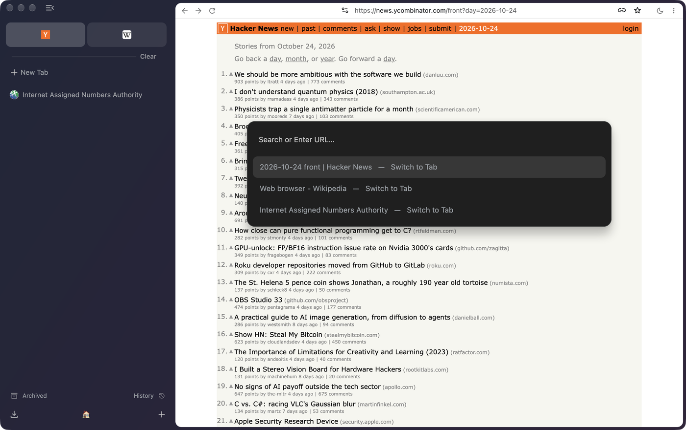
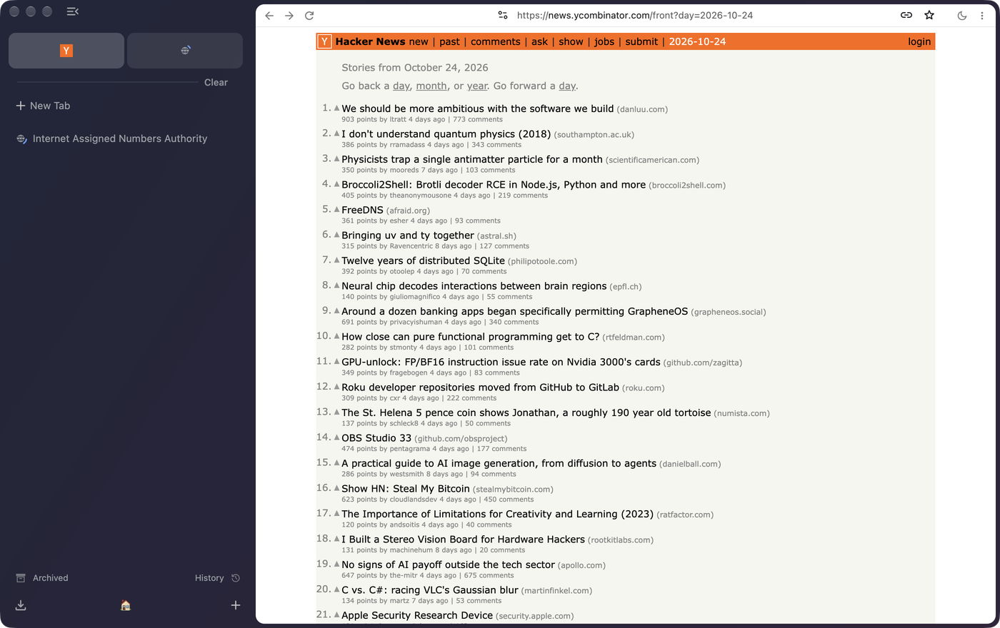
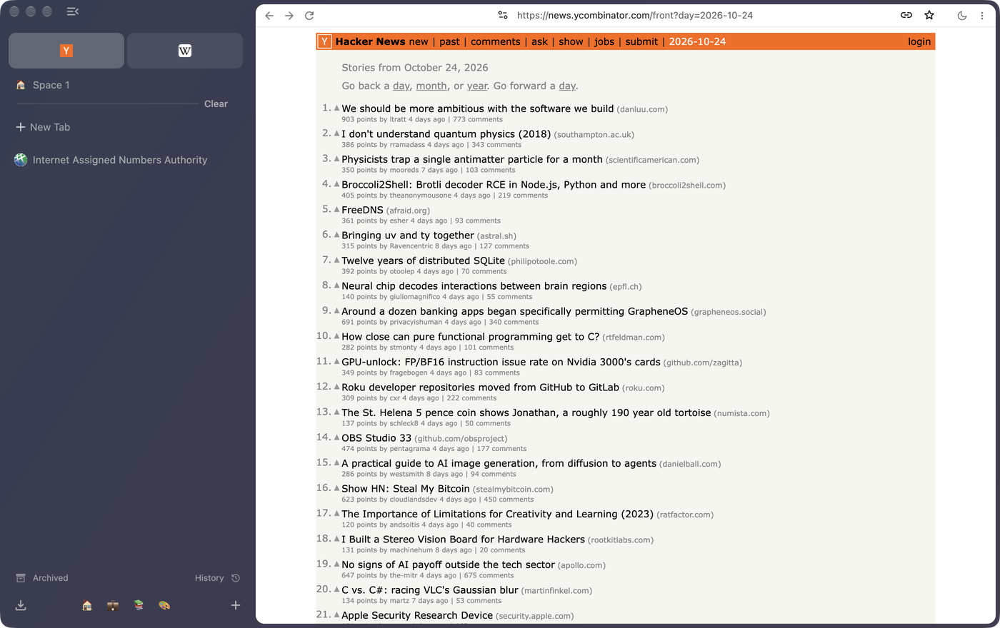

# Product specification

**Stedding targets full functional parity with Arc** (`decisions/0011-full-arc-parity.md`),
and goes past it where newer Arc-style browsers showed what people want (`ROADMAP.md` M10,
`decisions/0021-ideas-from-nook-and-aura.md`). This document is that inventory. It uses
Arc's terms for Arc's concepts, so it can be checked against Arc; where Stedding's name
differs, it is given beside Arc's (Favorites are **essentials**, Air Traffic Control is
**routing**, Little Arc is the **little window**).

It is a specification, not a status report. Each item names its home: the feature spec
under `features/` (built, partial or planned), a `BACKLOG.md` id, a milestone, or the
decision that deferred or cut it. The order of work is `BACKLOG.md`.

Arc is a fixed target: its maker put it in maintenance mode in May 2025 and moved to Dia
(`VISION.md`, "Competitors").

## How to read this

| Tier | Meaning |
|---|---|
| **[1.0]** | Required for parity. Ships before 1.0. |
| **[post-1.0]** | Real Arc behaviour, deferred deliberately, with the reason stated. |
| **[needs decision]** | Parity here conflicts with a documented out-of-scope item in `ROADMAP.md`, or needs infrastructure we do not have. Listed, not silently dropped. |
| **[not applicable]** | Exists in Arc but is a property of Arc's business, not a browser capability. |
| **[deferred]** | Real Arc behaviour, kept here but not in the first releases (ADR 0012). |
| **[never]** | Decided against for good (ADR 0020). |
| **[cut]** | Taken out by the owner's decision of 2026-09-26 (`PLAN.md`, decision 4; patch 0055 applied them). |
| **[M10]** | Beyond parity: `ROADMAP.md` M10, one `BACKLOG.md` id each, built from written descriptions (ADR 0021). Not a condition of 1.0 unless it says so. |

"No spec row yet" marks a feature with no home but this document.

Stedding ships on macOS and Windows (`decisions/0006-platform-order-macos-first.md`).
Linux is not shipped. A behaviour that works on one platform only says so here and in
its spec. Shortcuts are Arc's macOS chords; on Windows ⌘ reads as Ctrl and ⌥⌘ as
Ctrl+Alt (`features/windows.md` N7), except where a row names Chromium's own chord.
Every deliberate divergence from Chromium is in `features/shortcuts.md` and in
`SHORTCUTS.md`.

---

## 1. Sidebar and tabs

Top to bottom: the essentials, the Space title when the window has two or more Spaces,
**Pinned Tabs**, the Clear line, the **New Tab** row, **Unpinned Tabs**, the archive
line (Archived, then History), and the foot: the downloads button, the Space icons and
a `+` (`features/sidebar.md` Y44). The Library is not this foot (§9).

- **Sidebar** **[1.0]** — a vertical tab strip in place of the horizontal one, on
  Chromium's own vertical tabs (ADR 0010). `⌘S` closes and opens it. Closed, it shrinks
  to a rail of icons or, as a setting, hides completely: the page goes edge to edge and
  the pointer at the window's leading edge slides the sidebar back over it
  (`features/sidebar.md` Y19). State persists. Chromium's switch to horizontal tabs
  stays, and Spaces, pins and folders work there too (`PLAN.md` decision 1;
  `features/menus.md` M8, M9; `features/spaces.md` B34).
- **Row height and text size** **[1.0]**, Stedding's own — three tab row heights and a
  sidebar text size (`features/sidebar.md` Y1, Y2). The rail follows the row height
  (Y8, Y12).
- **Pinned Tabs** **[1.0]** — saved per Space, above the Clear line, never auto-archived.
  `⌘D` pins. Arc describes them as between an app and a bookmark: navigating *within*
  the site stays in the tab; **a link that would leave the site opens Peek (§5) instead
  of replacing the pinned page**. A pin remembers its home. A Space pin with a title
  shows Arc's slash while it is away from that home (`features/pins.md` H12). The dot
  on an essentials card and in the rail, and the card's reset control, show only while
  "Mark pinned tabs that left their page" is on, which is off by default (H28).
  Option-click on the favicon, or **Reset to Pinned Page**, goes home; a plain click
  only selects. While "⌘W on a pinned tab puts it to sleep" is on, which it is at
  first, `⌘W`, a middle click or the menu's Close unloads a pin and sends it back to
  its home, in its place, after a page's own "Leave site?" (`PLAN.md` decision 11;
  H3, H16). On a Space pin the close button is then a minus while the pin is awake
  ("Close, keep pinned", the same unload) and an x once it is asleep at home, which
  asks "Remove this pinned tab?" before the row goes (H29). With that setting off,
  `⌘W`, the close button and a middle click close the pin (H9). A new pin joins the end of the run (H14).
- **Favorites** **[1.0]** — Stedding's essentials: tabs visible in *every* Space, above
  the Space title, drawn as cards. Distinct from Pinned Tabs (`features/spaces.md` B6).
  They are shared by every Space, except in a Space with an Independent session, whose
  essentials are its own. That Space shows no shared essential, unless every Space has
  its own session, when the shared ones show in each (`PLAN.md` decision 14; `S-254`,
  GitHub issue 8, ADR 0028). Arc's importer takes the first twelve (import I11), and
  Import sidebar… stops at twelve the same way. Sync turns any past the twelfth into
  pins of the first Space (sidebar-file Sf41). The sidebar itself does not cap the row.
- **Unpinned Tabs** **[1.0]** — below the Clear line, auto-archived when idle once the
  user picks a time (§11). `⇧⌘K` clears them as a set (`features/spaces.md` B20). The
  Clear line is there even when nothing is pinned (B17).
- **Folders** **[1.0]** — group tabs; **tabs in folders do not auto-archive**. Folders
  nest; rename, move and delete from the header's menu; drag a tab in. A collection
  type in the tab tree, not a tab group (ADR 0013; `features/folders.md`). A folder can
  join the pinned run, dragged over the Clear line or by Pin Folder, and its tabs then
  behave as pins (F38). The Arc importer still makes a pinned folder an ordinary one
  (import I3, `S-107`). Essentials take no folder.
- **Separators** **[1.0]** — a Space pin or a tab, not an essential, a folder row or a
  split pane, can have a thin line above it, from the row's menu (Add Separator Above,
  or Remove Separator). It moves with the row and survives a restart
  (`features/sidebar.md` Y45). Not yet: a label, separators inside folders, and
  separators in an export or in folder sync (`S-286`).
- **Bookmarks** **[1.0]**, diverging — Arc has none; Pinned Tabs replace them. Stedding
  keeps Chromium's bookmarks (their menu rows stay; `⌘D` pins instead). Imported
  bookmarks stay bookmarks. The command bar's **Turn Bookmarks into Pinned Tabs** makes
  pins and folders of them when asked, asking first above 50 (import I13–I16). A
  conversion that made a pin hides the bookmark bar and the star; Settings → Stedding
  → Tabs → "Show the bookmark bar and the star" brings them back (`features/settings.md`
  T27). Converting them by itself after an import is **[cut]**.
- **Tab switching** **[1.0]** — `⌥⌘↑/↓` moves in sidebar order; `⌘1`…`⌘8` jump to the
  Nth visible row and `⌘9` to the last (`PLAN.md` decision 5; `features/tabs.md`
  R10–R13); `⌃⇥` walks the five most recently used tabs of the Space
  (`features/switcher.md`).
- **Favicons** **[1.0]** — per tab. A page that names no icon keeps the favicon its
  site gave the tab, never another site's (`features/tabs.md` R54).
- **Audio indicator and mute** **[1.0]** — the sound control mutes; an essentials card
  keeps its favicon and badges the sound, and a click on the badge mutes
  (`features/tabs.md` R18). A right-click on a silent tab offers Mute Site. `⌃M`
  (Ctrl+M on Windows) mutes or unmutes the selected tabs, from inside a split too (R29).
- **Collapse Pinned Tabs** **[1.0]** — hide the pinned list without hiding the sidebar,
  from the Space's menu or the command bar, per Space (`features/pins.md` H17).
- **Previews on hover** **[post-1.0]** — hovering a pinned tab glances the site: recent
  mail, calendar events, open pull requests. Deferred because each site is a bespoke
  integration. The hover affordance itself is **[1.0]**, as a screenshot of the tab with
  no model (ADR 0020; `S-115`): a row whose page is not on screen shows a picture of
  that page as last seen, held in memory only, on the Mac and on Windows, and a pinned
  tab's card also names its Space and home (`features/pins.md` H8, H19–H23).
- **Rename tab** **[1.0]** — double-click (`features/tabs.md` R14–R17).
- **Multi-select tabs** **[1.0]** — ⌘-click and ⇧-click, then every verb acts on the
  selection (`features/tabs.md` R20–R22).
- **Sleeping tabs** **[1.0]** — Sleep Tab and Sleep Other Tabs in This Space. A Space
  can put its tabs to sleep after you leave it; the default is Never (`PLAN.md`
  decision 3; `features/tabs.md` R6). Sleep skips a tab that is on screen, recently
  audible, capturing, or holding a device (R6). Also: tabs that sleep on a timer and
  under memory pressure (`S-111`, R39–R44), and a launch that loads only the selected
  tab (`S-110`, R45).
- **Drag a tab out** **[1.0]** — the tab opens in a window that shows the same Spaces
  (`features/windows.md` G1). A window that shares nothing is a Blank Window (§5).
- **Sidebar export** **[1.0]** — Export Space… writes the active Space; Export all
  Spaces… writes every Space with its pins, pinned folders and essentials. Import
  sidebar… merges by ids that survive a restart and closes nothing that is open
  (`features/import.md` I18, I20; `features/sidebar-file.md` Sf2, Sf6). Scheduled
  backups and the version-2 catalog are **[cut]**.
- **Sync through a folder** **[1.0]** — off by default. Each computer writes its sidebar
  to its own file in a folder the user picks and merges the others' edits field by
  field. A removal travels only from the user's own action. A large batch or a Space
  deletion waits for a yes. Settings keeps Undo and backups. Not a sync service: no
  account, no server, no network request; the user's own sync tool or a shared drive
  moves the files (`features/sidebar-file.md` Sf7–Sf42, ADR 0029, `S-282`). Rows still
  open are marked in that spec. The owner's acceptance of ADR 0029 is still open.
- **Copy URL, and copy as Markdown** **[1.0]** — `⇧⌘C` and `⌥⇧⌘C`, with tracking
  parameters removed, and a Copy Link button at the address field's right end.
  Option-click (Alt-click on Windows) copies the Markdown link. The button is on by
  default; a setting hides it (`features/copy-link.md` L7, settings T28; GitHub
  issue 11).
- **Reopen closed tab** **[1.0]** — `⇧⌘T`, Chromium's.
- **Child tabs** **[M10]** — a link opened in a new tab opens just below the page it
  came from. A setting, off by default, draws it indented under that page; a closed
  parent's children move up; the tree survives a restart (`features/tabs.md` R56–R59,
  settings T26). Not built: Back on a child at its first page returning to the parent
  and closing the child, a parent's children folding away with it, and Close Other Tabs
  keeping a tab's children (R60, `S-92`).
- **Undo after closing tabs** **[M10]** — after a close, a toast with Undo that reopens
  those tabs in their Space and folder. Off by default; a setting turns it on. The
  setting has no command-bar row (`features/tabs.md` R25–R28, R30).
- **The sidebar on the right** **[M10]** — "Sidebar on the right" in Settings, on the
  sidebar's own menu, the Mac's View menu and the command bar puts the sidebar at the
  window's right in every window at once. Its edge, rail, handle and reveal edge
  mirror, and the Mac's traffic lights stay left over the address row
  (`features/sidebar.md` Y34–Y43, `S-96`).

## 2. Spaces

- **Spaces** **[1.0]** — distinct browsing areas, each with its own pinned section,
  unpinned section, colour and icon: one tab strip filtered by the active Space
  (ADR 0015) and one Space list for every window (ADR 0016; `features/spaces.md`).
  `⌃1`…`⌃9` focuses a Space and `⌥⌘←/→` moves to the next or previous one. Over the
  sidebar a sideways scroll steps to the next or previous Space: a tilt wheel or Shift
  with the wheel, and on Windows a touchpad's sideways scroll and Ctrl with the wheel
  (`features/spaces.md` B39, `PLAN.md` decision 15, GitHub issue 10). On the Mac a
  two-finger swipe follows the fingers (B35). Windows steps without following the
  fingers (B39, `history/plan-2026-09-26.md` TAB-31). The icons live at the sidebar's foot.
- **Create, rename, reorder, delete** **[1.0]** — `+` creates. The Space's title row
  opens its menu (Edit Space…, colour, rename, delete). Drag a Space icon, or Move
  Left / Move Right, to reorder (B27). Deleting a Space asks first. The question names
  the Space, how many tabs it holds and where they go; the tabs stay open and move
  there. An independent session is wiped, and apps that keep it are named (B5, web
  apps Wa13). Only the last Space cannot be deleted (`PLAN.md` decision 7).
- **Theme and icon** **[1.0]** — Edit Space, from the Space menu or Settings: any
  emoji, and any colour from a palette or a picker, one colour for both looks or one
  for each of the light and dark looks, tinting the sidebar. Light, dark or automatic
  for the whole browser (`features/welcome.md` W4, W7; `features/spaces.md` B31,
  B41–B44). Not built: a two-colour gradient, and the command bar's selected row in
  the Space's colour.
- **Per-Space sessions** **[1.0]** — a Space can keep its own cookies, HTTP cache and
  site storage, so the same site can be signed in with different accounts in different
  Spaces of one window. Opt-in per Space; off, Spaces share the profile's jar.
  Extensions, settings, history and saved passwords stay on the profile. A Chromium
  `StoragePartition`, not a profile (ADR 0019; `features/sessions.md`). Binding two
  Spaces to one jar, or giving a Space its own extensions, needs a later ADR (`S-272`).
  A Space with its own session is marked wherever Stedding names it as a place to go:
  a cookie on its chip and after its name (`features/sessions.md` S32, S34,
  `features/spaces.md` B38). Its essentials are its own and stay in its session (S8,
  ADR 0028).
- **Move tabs between Spaces** **[1.0]** — the command bar's "Move Tab to [Space]", the
  tab menu, `⌥⇧⌘←/→`, or a drag onto a Space icon (`features/spaces.md` B12, B22).
- **Air Traffic Control** **[1.0]** — Stedding's routing: rules sending a site, a part
  of an address or an exact address to a Space, plus a default Space for links from
  other applications (`features/routing.md`). A site rule is made from the tab menu
  ("Always Open <site> in"); Settings lists each Space's rules, with add and remove
  (D5). Not built: "Route sites here…" on the Space menu, and "Sort open tabs by these
  rules now" (D5, `S-126`).
- **Focus and Hide Other Spaces** **[1.0]**, Stedding's own — one Space on screen at a
  time, from the command bar (`features/focus.md`, `features/share-coat.md`). Focus
  does not survive a restart (focus Fc3, `S-61`). The coat does not arm itself when a
  tab captures the screen (share-coat Sc2, `S-61`).
- **Live Folders (GitHub)** **[post-1.0]** — a folder filled with your open pull
  requests. A bespoke integration; deferred, not dropped. No spec row yet.
- **Live Calendars** **[post-1.0]** — a pinned calendar counts down to the next event
  with a Join button. Same reasoning. No spec row yet.
- **Share Space** **[needs decision]** — publishes a snapshot of a Space to a public
  URL. Needs hosting we do not have, and shared links cannot be deleted by the sharer.
  The local half, exporting a Space, is §1.
- **Share Quote** **[needs decision]** — the same: a hosted link whose preview image
  holds the quoted text.
- **A throwaway Space, Copy Tab to Space, a clipboard fenced per Space** — **[cut]**
  (`features/throwaway.md`, `features/clipboard.md`, `features/sessions.md` S14–S15).

## 3. Command bar

- **Command bar** **[1.0]** — Arc's combined new tab, URL entry, search, tab switcher
  and action palette. `⌘T` opens it and lists open tabs from every Space first; `⌘L`
  opens it with the page's address in it (`features/commandbar.md`). Stedding keeps an
  address row on top of the page that shows the whole address (`ROADMAP.md` M4;
  `features/toolbar.md` T28–T30).
- **Actions mode** **[1.0]** — `⇥` in an empty bar, a leading `>`, or `⇧⌘P`. It lists
  Stedding's verbs, an allow-list of the window's commands and rows for most of
  Stedding's settings (`features/commandbar.md` K8–K17, K22, K28, K29). Not every
  setting has a row: the sidebar's width (`features/settings.md` T7,
  `features/sidebar.md` Y22) and Undo after closing tabs (`features/tabs.md` R30) do
  not. Preference rows in the bar and in Settings are not generated from one table
  (`S-158`). There is no Split View row.
- **Site Search** **[1.0]** — a search engine's keyword, then the query, searches that
  site directly, from Chromium's own keywords and their `%s` templates (K18). `@Space`
  narrows the list to a Space (K19). Tab after a site's name turns it into a search
  chip, the list being Chromium's own search engine settings (K27). Typing completes
  to a site from history, the rest selected (K23).
- **Full URL in Toolbar** **[1.0]** — the address row, on by default. `⇧⌘D` shows or
  hides it for the window until the sidebar's state changes. A setting, off by
  default, hides it when the sidebar closes (`features/toolbar.md` T8–T12).
- **Instant Links** **[needs decision]** — `⇧↵` opens the top result instead of the
  results page. No spec row yet. The "Folder of …" variant is AI and **[never]** (§8).
- **Ranking** **[1.0]** — the typed text's own row first, and a site search it names,
  then up to four open tabs, the active Space's first and then the other Spaces', each
  in the strip's order, up to three archived tabs, blank documents for text that
  starts with "new", then the omnibox's suggestions as they arrive. Nothing is scored
  (`features/commandbar.md` K2, K4, K5, K7, K27, K28).

## 4. Split View

- **Split View** **[1.0]** — two pages side by side in one window, on Chromium's own
  split view. Made with `⌃⌘N` on the Mac (the current tab and a new one). Chromium's
  `⌥⌘N` also splits, except while Arc is running and takes that chord (`S-79`), or
  from a tab's menu. Dragging a tab onto the page makes one too, from the sidebar or
  the horizontal strip: the half under the pointer lights in the Space's colour, and
  the dropped page takes that half (`features/splits.md` J10–J15; GitHub issue 7).
  More than two panes are **[post-1.0]**. Stacked panes are drawn, and a switch
  between side by side and stacked redraws the corners (splits J7).
- **A split is a tab** **[1.0]** — one sidebar row, and one unit for pin, sleep, move
  to a Space and rename (`features/splits.md` J1, J4).
- **Persistence** **[1.0]** — returning to the row, and a restart, bring the split back
  (J1). What `⌘W` does on a split is still to be decided (J3; `S-102`). Whether a
  Space pin that joins a split leaves the pinned run is the same open item (J5).

## 5. Transient windows

- **Peek** **[1.0]** — a link from a pinned tab or an essential that leaves its site
  opens in a peek: a little window over that window, its page a whole tab in the pin's
  jar, instead of navigating the pinned tab away. "Open as Tab" (`⌘O`) and "Open in
  Split View" (`⇧⌘O`, beside the pinned tab) move the page into the window without a
  reload. An essential's peek, and a peek of a tab already in a split, offer Open as
  Tab alone (`features/peek.md` P9). Escape or a click on the window closes it. On by
  default (`PLAN.md` decision 2), with its switch in Settings › Stedding and on the
  welcome flow. "Open a peek with" can ask for a press held 0.3 s or 0.5 s instead of
  a click, so a plain click follows the link in the pinned tab (P18).
- **Little Arc** **[1.0]** — the little window: a link from another application opens
  in a small window of its own, to read and dismiss. On the Mac its top is one row,
  the main window's address row on the page's colour, with the traffic lights inline
  (`features/little.md` E8, E9). `⌘O` or the row's "Open in Stedding" button moves the
  page into the main window (a new one when none is open) and `⇧⌘O` into a split, as
  the page's menu and the File menu also offer (E7). On Windows the same moves are
  Ctrl+O and Ctrl+Shift+O, and the window keeps Windows' own title bar (E10). It has
  no Space commands (`PLAN.md` decision 9). No chord opens one: `⌥⌘N` splits, as
  `⌃⌘N` does (E5). A little window is never closed for being idle (E3; the idle close
  is **[cut]**).
- **Folder peek** **[post-1.0]** — hover a closed folder, search or scroll it, and open
  one tab without expanding it. No spec row yet.
- **Blank Window** **[1.0]** — a window that does not share the Spaces, `⌥⇧⌘N`
  (`features/windows.md` G4).
- **Incognito Window** **[1.0]** — Chromium's private window, in colours of its own,
  with nothing reaching the sidebar's model, the session or the archive
  (`features/private.md`).
- **A page already open in another window** **[M10]** — not built. A pin is a tab of
  one window. There is no ghost row in the other windows, and no "Show here / Go to
  window" (`features/windows.md` G2, `S-94`).

## 6. Boosts — [deferred]

Deferred by `decisions/0012-defer-boosts-and-easels.md`. The reasons, and what brings
them back, are there and in `ROADMAP.md` ("Deferred, with the intent to return"):

- **Boosts** — per-site restyling: colour, inverted lightness for a dark mode,
  contrast, brightness and saturation, font presets, size 90–150%, capitalization, and
  **full CSS and JavaScript editors**.
- **Zap** — click a page element to hide it on that site's pages; `\` restores.
- **Sharing Boosts** — Arc hosted a gallery. The local half, a Boost exported and
  imported as a file, is the part worth having.

Extensions answer all three today (Stylus, Violentmonkey, uBlock Origin's element
picker). A Boost is a script host, so a threat model comes before any code. When they
return, Aura's editor is the model: a live preview while typing and a switch per site
in the page menu (ADR 0021).

## 7. Easels and captures

- **Captures** **[1.0]** — the page as shown, a region, or the whole document, as a PNG
  in Downloads and on the clipboard (`⇧⌘2`, `⌥⇧⌘2`, `⇧⌘1`; `features/screenshot.md`).
  Arc sends a region to an Easel; without Easels it goes to the file and the clipboard.
- **Easels** **[deferred]** — whiteboards holding captures, drawings and text
  (ADR 0012). Captures stay **[1.0]**.
- **Arc Notes** **[not applicable]** — Arc removed them. Parity with a feature it
  deleted is not a gap.
- **New Documents** **[1.0]** — command bar rows that open a blank document through the
  service's own .new address: Google Docs, Sheets, Slides and Forms, Notion, Figma, a
  GitHub repository, a GitHub gist, Word, Excel and PowerPoint
  (`features/commandbar.md` K28).

## 8. Arc Max (AI) — [never]

Arc Max bundles 5-second previews on hover, tidy tab titles, tidy downloads, tidy tabs,
Ask on Page, Instant Links and ChatGPT in the command bar.

**Stedding ships no bundled model** (`decisions/0020-no-bundled-model.md`). Command-bar
chat, Ask on Page, Instant Links' "Folder of …", and a persistent agent holding a
Space's cookies are never. So are the AI features of Nook and Aura (a sidebar chat, a
tab organiser, an agent-control server, "Browse for Me"; ADR 0021). The halves without
a model stay: downloads grouped by the day they started (**[1.0]**, as the Downloads
panel, `features/sidebar-panels.md` Pn9; grouping by kind is not planned,
`features/library.md` Lb5), the *hover preview* as a screenshot of the tab (**[1.0]**,
§1), and *tidy titles*, which may ship later as an optional local heuristic (ADR 0020;
no spec row yet).

## 9. Media and downloads

- **Picture-in-picture** **[1.0]** — `⌥⇧⌘P` (Ctrl+Alt+Shift+P on Windows) puts the
  page's video in Chromium's picture-in-picture window and brings it back
  (`features/player.md` Mp5). A player clipped to the page card, an audio strip for a
  tab playing sound, and a video that follows you into the sidebar are not built
  (Mp1–Mp4, `S-95`).
- **Downloads** **[1.0]** — Chromium's downloads, with the progress ring on the
  sidebar's downloads button (`features/toolbar.md` T14). The button opens the
  Downloads panel in the sidebar's column (`features/sidebar-panels.md` Pn2).
- **History and Downloads panels** **[M10]** — History and Downloads open in the
  sidebar's column, in the tabs' place (`features/sidebar-panels.md`, `S-98`). History:
  `⌘Y` on the Mac, Ctrl+H on Windows. Downloads: `⇧⌘J` or `⌥⌘L` on the Mac, Ctrl+J on
  Windows. "Open History and Downloads in the sidebar" is on by default; off, the keys
  open Chromium's pages and the downloads button opens the bubble (Pn14).
- **Library** **[1.0]** — archived tabs, captures and downloads in one place, and
  easels when they return. Not built (`features/library.md` Lb1–Lb7, `S-61`). Archived
  tabs have their own row and page (§11). Captures are files in Downloads (§7).

## 10. Profiles, windows, sync

- **Profiles** **[1.0]** — Chromium's profiles, as Chromium has them. Arc binds a
  profile to a Space; Stedding gives a Space cookies of its own instead (§2,
  ADR 0019). The Arc importer drops a profile binding and says so
  (`features/import.md` I8).
- **Multi-window and multi-display** **[1.0]** — every window shows the same Spaces.
  Blank Windows are independent (ADR 0016; `features/windows.md`). Essentials and pins
  are per window (G1). A ghost row in the other windows is not built (G2, `S-94`).
- **Arc Sync** **[1.0, as sync through a folder]** — cross-device sync of Spaces, pinned
  tabs and order. `ROADMAP.md` puts sync services out of scope and `PRIVACY.md` runs
  no accounts, so the answer is the folder in §1 (ADR 0029). A Space still travels as
  a file. Open tabs, history and passwords do not travel.
- **Recovery Card** **[not applicable]** — recovery for an Arc account we do not have.
- **Arc account / sign-in** **[not applicable]** — Stedding ships no account.

## 11. Archive, history, search

- **Auto Archive** **[1.0]** — idle unpinned tabs archive after a set time, reset by
  viewing the tab. Nothing pinned, in a folder or in use is archived. Arc archives
  after 12 hours by default and does not let you turn it off. Stedding's default is
  Never, and the choices are Never, 6 hours, 12 hours, 1 day, 3 days and 7 days. The
  welcome flow asks (`features/archive.md` A6, `features/welcome.md` W12).
- **View and restore the archive** **[1.0]** — the Archived row opens the Archived
  view, by day and Space and searchable, and archived tabs appear in the command bar
  (archive A7–A11).
- **History** **[1.0]** — `⌘Y` on the Mac and Ctrl+H on Windows. As a panel in the
  sidebar's column, with Chromium's page one click away, **[M10]**
  (`features/sidebar-panels.md`, `S-98`).
- **Find in page** **[1.0]** — `⌘F`, Chromium's.

## 12. The rest

- **Keyboard shortcut customisation** **[1.0]** — the Shortcuts block in Settings is
  editable (`S-91`, `features/shortcuts.md` Z5, Z10–Z22): record a chord, a conflict
  named before it is taken, a switch per command, Reset per row and for all, search
  and a group filter. The chords are the computer's, kept in Local State.
- **Site Control Center** **[1.0]** — per-site permissions and controls from the address
  row: Chromium's page info, with Stedding's controls in it, from the site chip and
  the command bar (`features/site-controls.md`, `S-118`). The blocker's per-site
  switch is the shield on the address row (`features/blocker.md`), not a row of this
  panel. Its entry to Boosts waits on Boosts.
- **Developer Mode** **[1.0]** — a localhost page always shows the address row
  (`features/toolbar.md` T11). Its tab is marked in the sidebar: a yellow and black
  tape round the row while it is on screen, and at the Comfortable density its host
  and port under the title, with a setting to turn the mark off
  (`features/local-tabs.md`). Arc's other developer affordances are still open
  (`S-117`).
- **Extensions** **[1.0]** — full Chrome Web Store compatibility, a hard requirement
  (`AGENTS.md`). `⌘E` (Ctrl+Alt+E on Windows) runs one: hold to choose, let go to run.
  The command bar's actions mode lists each extension, so they stay reachable with the
  address row hidden (`features/toolbar.md` T13, T39, T40; `S-104`).
- **Import from another browser** **[1.0]** — Arc in one step, on the Mac and on
  Windows (`features/import.md` I21, I27, `S-81`). Dia's bookmarks, history and
  passwords, and the file Safari exports, on both platforms (**[M10]**, I28–I32,
  I34–I42, `S-101`). Dia's sidebar is not imported (I33). Chromium's own importer
  offers Safari and Firefox on macOS, and Firefox, Internet Explorer and the old Edge
  on Windows (`features/welcome.md` W3). Chrome, Brave, the new Edge, Vivaldi and
  Chromium are not offered (`PLAN.md` decision 8).
- **Progressive Web Apps** — Arc does not install them and points users to Favorites.
  No tier is decided. Any page can become an app of its own, on Chromium's web apps:
  "Add to Dock…" on the Mac (the File menu, the app menu, the command bar), with a
  Dock tile and a launcher in Stedding Apps, and "Install page as app…" on Windows,
  with a Start menu entry (`features/web-apps.md` Wa1, Wa2, Wa7, Wa8). The app's
  window has no sidebar and no Stedding card; it has its own title bar (Wa9). The app
  keeps the session of the Space it was made in (ADR 0025) and takes no
  links from the browser until the user turns that on for it (Wa15).
- **Arc Search (iOS/Android)** **[not applicable]** — mobile is out of scope
  (`ROADMAP.md`).

## 13. Beyond parity (M10)

What Arc never had, rebuilt from written descriptions of Nook and Aura and never copied
(ADR 0021; `ROADMAP.md` M10). Besides the **[M10]** items above:

- **Ad and tracker blocking built in**, with a switch per site, on Chromium's
  subresource filter. Lists are fetched at run time, never built in (`S-88`,
  ADR 0030, `features/blocker.md`). Phase 1 is in the series and off by default:
  EasyList and EasyPrivacy, from easylist.to, only after the user turns it on, and a
  shield on the address row. ADR 0030 is still proposed. Element hiding, a card for a
  blocked top-level load, optional lists and a count are not built (Bk20–Bk23).
- **Clean links on every page opened** (`S-89`, `features/clean-links.md`). A page you
  open loses the tracking parameters a copy loses, and a known redirect page that
  carries its target is skipped. A shortener whose target is not in its address is
  not skipped (Cl3). The setting is on by default. Settings → Stedding → Privacy
  turns it off and can keep a site's parameters (Cl7, Cl8).
- **Web apps keep their own keys** — not built. The first press would go to the page
  and a second to Stedding (`S-90`).
- **Dark mode for web pages**, on Chromium's own (`S-100`): one switch, off by
  default, a moon at the address row's right end, `⌥⇧⌘D`, a command bar row, a
  page-menu row and, on the Mac, a View menu row, with sites kept light or the only
  ones darkened, and an app's title bar darkened with its page
  (`features/dark-pages.md`).
- **Smaller things.** Built: clear a site's cookies and reload
  (`features/commandbar.md` K24, `features/sessions.md` S27), folder verbs
  (`features/folders.md` F30–F33), a pin's home address edited by hand
  (`features/pins.md` H15), mute and picture in picture by key (`features/tabs.md`
  R29, `features/player.md` Mp5), the sidebar's edge showing where to drag and a
  double click that resets its width (`features/sidebar.md` Y22), the page flush
  against the window (Y23), Close Duplicate Tabs (commandbar K26), a middle click on
  the sidebar's empty ground that opens the command bar (Y24), and a switch for the
  link address shown on hover (`features/page.md` U9). Not built (`S-125`): an empty essentials row that says it
  is a drop target, each Space's stored size in Settings, and "Open in the system
  viewer" on the PDF viewer.

---

## What parity does not cover

Three areas collide with a documented out-of-scope item:

1. **AI (§8)** — closed by ADR 0020: no bundled model, no Space intern.
2. **Sync (§10)** — no Stedding account or server. The sidebar travels through a
   folder the user's own sync tool keeps (ADR 0029), or as a file. Open tabs, history
   and passwords stay on each computer.
3. **Hosted sharing (§2, §6)** — Share Space, Share Quote, the Boost gallery.

So "full parity" means parity with the local, offline capabilities of Arc, with the
gaps listed. With Boosts and Easels deferred (ADR 0012), the target until that is
revisited is **parity minus Boosts and Easels**.

## Where we deliberately differ

- **No account.** Arc requires one.
- **Auto Archive is off until you pick a time.** Little windows are never closed for
  idling.
- **An address row with the whole address**, where Arc has none.
- **Bookmarks stay**, beside pinned tabs.
- **Chromium's horizontal tabs stay one switch away.**
- **No telemetry**, per `PRIVACY.md`.
- **No bundled model, no Space intern, no command-bar chat** (ADR 0020).
- **Open source under BSD** (ADR 0002).

## UI spec

The target is a close, measured match of Arc's window chrome, taken from reference
screenshots of Arc on macOS. This section holds the targets and the values Stedding
ships. The behaviour of each surface, with its tests, is in its feature spec
(`features/sidebar.md`, `features/toolbar.md`, `features/tabs.md`, `features/page.md`,
`features/commandbar.md`). Where this section disagrees with a screenshot of Arc, the
screenshot wins and this section is corrected.

Chromium's built-in vertical tab strip supplies the tab model
(`decisions/0010-ride-upstream-vertical-tabs.md`). It is not the appearance.

### The layout

The page sits on a rounded card, with the window's ground as a mat at the top, the
right and the bottom (the `card_gutter`, 6 DIP; the sidebar side has none). The
address row is the top of that card, with no gap under it and a hairline a tenth of the contrast colour where it meets the page, in the
page's own colour: the colour the page draws along its top edge, else its
`theme-color`, else its background, with the row's icons and text flipped for
contrast (`features/toolbar.md` T3, T7, T15, T31). With the sidebar hidden completely,
or in a full screen with no address row, the page is edge to edge with no gutter and
no rounded corner (`features/sidebar.md` Y19, `features/toolbar.md` T33). The setting
"Page flush against the window", off by default, does the same beside an open sidebar
(`features/sidebar.md` Y23).

### Targets and shipped values

The reference values are pixels measured on a 2000×1293 screenshot of Arc. Stedding's
are DIP, the defaults of the `SteddingArcStyleWindow` feature parameters
(`chrome/browser/ui/stedding_ui_metrics.cc`, patch 0002), unless a row says they were
measured on a capture. Density changes the row, the favicon, the essentials card and
the corner radius (sidebar Y1); Comfortable is the match below.

| Element | Arc reference | Stedding |
|---|---|---|
| Sidebar width | ~352 px, user-resizable, persisted | 352 default; resizable from 126 to 480 by its edge or Settings (`features/settings.md` T7, `features/sidebar.md` Y18) |
| Card corner radius | ~12 | 12 (`contents_corner_radius`); the top corners belong to the address row while it shows (toolbar T16) |
| Card gutter | the mat around the page | 6 (`card_gutter`) at the top, the right and the bottom |
| Address row | thin, on the window ground | 33 on the capture below: 28 DIP buttons (`toolbar_button_height`) and a 25 DIP field (`location_bar_height`), against Chromium's 46 |
| Tab row height | ~48 | 44 (`vertical_tab_height`); 36 and 30 at Compact and Dense (sidebar Y1) |
| Favicon | ~18, left inset ~28 | 18 (`tab_favicon_size`); 16 at Compact and Dense. In the rail, 22, and 20 at Compact and Dense (sidebar Y1, Y8) |
| Active tab | a filled rounded rect, radius ~10, inset ~10 | radius 10 (`vertical_tab_corner_radius`); 8 and 6 at Compact and Dense (Y1) |
| Essentials | a grid of cards at the very top, ~150×50, radius ~12, icon only | 50 tall at Comfortable (40 and 34 at Compact and Dense). Up to four on one row, each a quarter of the row at most; a lone card spans the row (Y33) |
| Space switcher | at the bottom: ~24 icons, one per Space, and a trailing `+` | 24 DIP chips, 12 DIP apart. When they do not fit, the gaps close to 4 DIP, then the chips shrink to 16, then inactive chips become 6 DIP dots (`features/spaces.md` B11, B24) |

### Sidebar, top to bottom

| Element | What it is |
|---|---|
| **Essentials** | The cards above all Spaces: visible whichever Space is active, except a Space with an Independent session, which shows only its own, unless every Space has its own session, when the shared ones show in each (ADR 0028) |
| Space title | The active Space's icon and name, when there are two or more Spaces. It opens the Space menu (spaces B16) |
| Space-pinned tabs | Ordinary rows, favicon and title, pinned within the current Space, and folders of them (folders F38) |
| Clear line | A hairline with `Clear` at its right end, which closes the Space's unpinned tabs and leaves the pins (spaces B17, B20) |
| `New Tab` row | A plus glyph and label, muted, above the unpinned tabs. It opens the command bar |
| Unpinned tabs | The rest, folders among them |
| Archive line | Archived at the start, History at the end (sidebar Y44, sidebar-panels Pn15) |
| **Space switcher** | The foot: the downloads button at the left, the Space chips in the middle, `+` at the right |

### Address row

Back, forward and reload at the left; extension icons and the app menu at the right,
with no profile avatar. No omnibox chrome: no background, no border. The field takes
the row between the button clusters. At rest the address gathers on the page's centre
and shows the whole address, the host in the text colour and the rest a step dimmer
(`features/toolbar.md` T18, T28–T30). Arc shows the bare host. Chromium's "Always show
full URLs", switched off from the field's menu, gives that. The preference starts on.

### Command bar



⌘T opens a centred overlay, not a focused omnibox: a rounded panel in the theme's
dialog colours with a result list beneath the field. The results mix open tabs in the
current Space, tabs in other Spaces labelled with their Space, and ordinary
suggestions and search (`features/commandbar.md`). The bar searches every Space, which
is why one tab strip holding every Space's tabs (ADR 0015) is the model.

### How it is checked



The pictures in this section are from 0.4.0 beta 1, dark, with two essentials and a page
that stays light (Hacker News has no dark theme), so the card stands out from the window
ground. The four Spaces add `extra_spaces/3/space_pin_tabs/1` to the params, the command
bar `open_command_bar/true`, and the welcome flow is `--stedding-welcome=search`. Each is
taken at Retina size and halved to 1400 × 880, one pixel to a DIP:

```
tooling/capture-state --size 1400x880 --seed dark --settle 30 \
  --features 'SteddingArcStyleWindow:pin_tabs/2' \
  'https://news.ycombinator.com/front?day=2026-10-24' \
  https://en.wikipedia.org/wiki/Web_browser https://www.iana.org/
```



`tooling/capture-state` takes the window by its id and needs neither the keyboard nor a
click; before the launch it parks the pointer off the window (`docs/HANDOFF.md`, trap 136).
It runs on macOS. On Windows the capture is `tooling/win/capture.ps1`.
`tooling/probes/window.json` is the probe spec; `tooling/dev capture --assert
tooling/probes/window.json` runs that spec's own capture and checks it.
`tooling/check-geometry` re-measures the gutters and the corner radius in the
committed images.

The corner radius, the row height and the pill radius are feature parameters, so a
value can be tried on a build that already exists:

```
tooling/capture-state --size 1400x880 --features \
  'SteddingArcStyleWindow:contents_corner_radius/16/vertical_tab_height/48'
```

Pins, folders and an open command bar for a capture come from those parameters
(`pin_tabs`, `space_pin_tabs`, `folder_tabs`, `open_command_bar`), listed in
`HANDOFF.md` ("Dev parameters").
