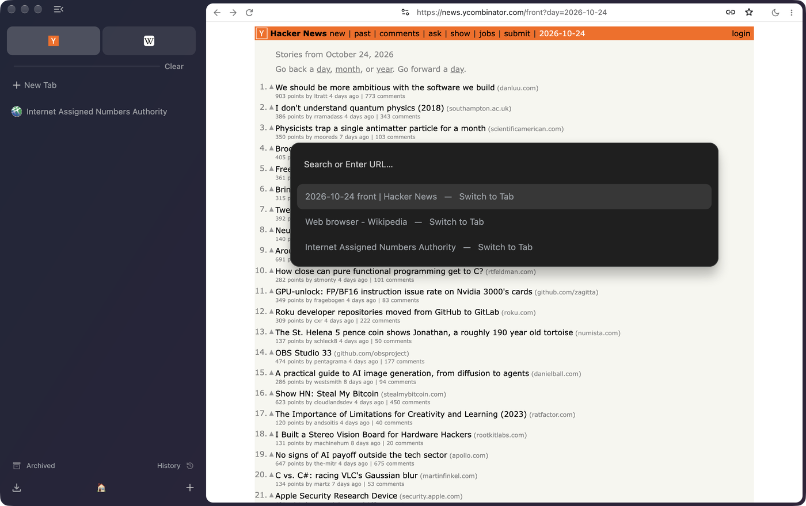
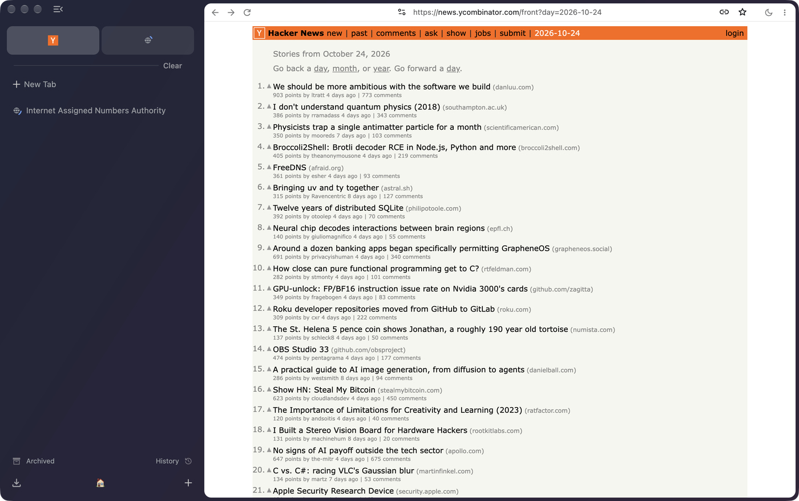
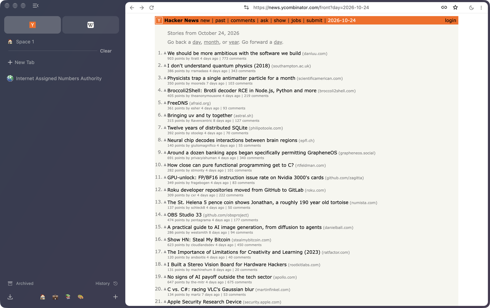

# Product specification

**Stedding targets full functional parity with Arc** (`decisions/0011-full-arc-parity.md`),
and goes past it where newer Arc-style browsers showed what people want (`ROADMAP.md` M10,
`decisions/0021-ideas-from-nook-and-aura.md`). This document is that inventory. It uses
Arc's terms for Arc's concepts, so it can be checked against Arc; where Stedding's name
differs, it is given beside Arc's (Favorites are **essentials**, Air Traffic Control is
**routing**, Little Arc is the **little window**). Arc is a fixed target: it is in
maintenance and will be sunset (`VISION.md`, "Competitors").

Each item names its tier and its home: the feature spec under `features/`, a `BACKLOG.md`
id, or the decision that deferred or cut it. **The specs are the detailed truth.** Each
holds the behaviour row by row, with its test and whether it is built. This page
summarises and does not restate them. The order of work is `BACKLOG.md`.

## How to read this

| Tier | Meaning |
|---|---|
| **[1.0]** | Required for parity. Ships before 1.0. |
| **[post-1.0]** | Real Arc behaviour, deferred deliberately, with the reason stated. |
| **[needs decision]** | Parity here conflicts with a documented out-of-scope item in `ROADMAP.md`, or needs infrastructure we do not have. Listed, not silently dropped. |
| **[not applicable]** | Exists in Arc but is a property of Arc's business, not a browser capability. |
| **[deferred]** | Real Arc behaviour, kept here but not in the first releases (ADR 0012). |
| **[never]** | Decided against for good (ADR 0020). |
| **[cut]** | Taken out by the owner's decision of 2026-09-26 (`PLAN.md`, decision 4; patch 0055 applied them). |
| **[M10]** | Beyond parity: `ROADMAP.md` M10, built from written descriptions (ADR 0021). Not a condition of 1.0 unless it says so. |

"No spec row yet" marks a feature with no home but this document.

Stedding ships on macOS and Windows (`decisions/0006-platform-order-macos-first.md`).
Linux is not shipped. A behaviour that works on one platform only says so in its spec.
Shortcuts are Arc's macOS chords; on Windows ⌘ reads as Ctrl and ⌥⌘ as Ctrl+Alt
(`features/windows.md` N7), except where a row names Chromium's own chord. Every chord, and
every deliberate divergence from Chromium, is in `features/shortcuts.md` and `SHORTCUTS.md`.

---

## 1. Sidebar and tabs

The sidebar's layout, top to bottom, is in "UI spec" below (`features/sidebar.md` Y44).

- **Sidebar** **[1.0]** — a vertical tab strip in place of the horizontal one, on Chromium's
  own vertical tabs (ADR 0010). `⌘S` closes and opens it. Closed, it shrinks to a rail of
  icons or, as a setting, hides completely and slides back over the page from the window's
  edge (`features/sidebar.md` Y19; `features/settings.md` T37, T38). Chromium's switch to
  horizontal tabs stays, and Spaces, pins and folders work there too (`PLAN.md`
  decision 1).
- **Row height, text size and appearance** **[1.0]**, Stedding's own — three row heights and
  a sidebar text size (`features/sidebar.md` Y1, Y2); the window's colour, a Space's tint
  and how strongly the active tab stands out (`features/settings.md` T41–T43).
- **The address in the sidebar** **[1.0]**, a setting, off by default — Back, Forward,
  Reload and the page's site at the sidebar's top, as Arc has them (`features/sidebar.md`
  Y46).
- **Pinned Tabs** **[1.0]** — saved per Space, above the Clear line, never auto-archived.
  `⌘D` pins. Navigating within the site stays in the tab; **a link that would leave the
  site opens Peek (§5) instead of replacing the pinned page**. A pin remembers its home;
  Option-click on the favicon, or Reset to Pinned Page, goes back. While "⌘W on a pinned
  tab puts it to sleep" is on, as it is at first, `⌘W` unloads a pin and sends it home
  rather than closing it (`PLAN.md` decision 11). Pins are the profile's, in every window
  (ADR 0035). Behaviour: `features/pins.md`.
- **Favorites** **[1.0]** — essentials: cards above the Space title, in every Space and every
  window, distinct from Pinned Tabs. A Space with a session of its own has essentials of its
  own (`PLAN.md` decision 14, ADR 0028; `features/spaces.md` B6, `features/sidebar.md`
  Y33).
- **Unpinned Tabs** **[1.0]** — below the Clear line, auto-archived only once the user picks
  a time (§11). `⇧⌘K` clears them as a set (`features/spaces.md` B17, B20).
- **Folders** **[1.0]** — a collection type in the tab tree, not a tab group (ADR 0013).
  They nest, and **tabs in folders do not auto-archive**. A folder can join the pinned run,
  and its tabs then behave as pins (`features/folders.md` F38). Essentials take no folder.
- **Separators** **[1.0]** — a thin line above a pin or a tab, from the row's menu
  (`features/sidebar.md` Y45). The rest is `S-286`.
- **Bookmarks** **[1.0]**, diverging — Arc has none; Pinned Tabs replace them. Stedding keeps
  Chromium's bookmarks, and imported bookmarks stay bookmarks. The command bar's **Turn
  Bookmarks into Pinned Tabs** converts them when asked (`features/import.md` I13–I16).
  Converting them by itself after an import is **[cut]**.
- **Tab switching** **[1.0]** — `⌥⌘↑/↓` in sidebar order; `⌘1`…`⌘8` the Nth visible row and
  `⌘9` the last (`PLAN.md` decision 5; `features/tabs.md` R10–R13); `⌃⇥` the recently used
  tabs of the Space (`features/switcher.md`).
- **Favicons, audio indicator and mute** **[1.0]** — per tab; mute from the sound badge,
  Mute Site, or `⌃M` (`features/tabs.md` R18, R29, R54).
- **Collapse Pinned Tabs** **[1.0]** — per Space (`features/pins.md` H17).
- **Previews on hover** — Arc's glance at a site's mail, events or pull requests is
  **[post-1.0]**: each site is a bespoke integration. The hover card itself is **[1.0]**: a
  picture of the page as last seen, with no model (ADR 0020; `features/pins.md` H8,
  H19–H23).
- **Rename tab** **[1.0]** (`features/tabs.md` R14–R17). **Multi-select tabs** **[1.0]**
  (R20–R22).
- **Sleeping tabs** **[1.0]** — Sleep Tab and Sleep Other Tabs; a Space can sleep after you
  leave it, Never by default (`PLAN.md` decision 3); tabs that sleep on a timer; a launch
  that loads only the selected tab (`features/tabs.md` R6, R39–R48).
- **Drag a tab out** **[1.0]** — into a window that shows the same Spaces
  (`features/windows.md` G1). A window that shares nothing is a Blank Window (§5).
- **Sidebar export** **[1.0]** — Export Space…, Export all Spaces… and Import sidebar…
  (`features/sidebar-file.md` Sf2, Sf6; `features/import.md` I18, I20). Scheduled backups
  and the version-2 catalog are **[cut]**. Sync is §10.
- **Copy URL, and copy as Markdown** **[1.0]** — `⇧⌘C`, `⌥⇧⌘C`, and a Copy Link button at
  the address field's end, with tracking parameters removed (`features/copy-link.md`).
- **Reopen closed tab** **[1.0]** — `⇧⌘T`, Chromium's.
- **Child tabs** **[M10]** — a link opened in a new tab opens just below the page it came
  from; drawn indented as a setting, off by default; Back at a child's first page returns
  to the parent (`features/tabs.md` R56–R60).
- **Undo after closing tabs** **[M10]** — a toast with Undo, off by default
  (`features/tabs.md` R25–R30).
- **The sidebar on the right** **[M10]** — one setting, every window
  (`features/sidebar.md` Y34–Y43).

## 2. Spaces

- **Spaces** **[1.0]** — distinct browsing areas, each with its own pinned and unpinned
  tabs, colour and icon: one tab strip filtered by the active Space (ADR 0015) and one Space
  list for every window (ADR 0016; `features/spaces.md`). `⌃1`…`⌃9` and `⌥⌘←/→` switch, and
  so does a sideways scroll over the sidebar (`PLAN.md` decision 15). On the Mac a
  two-finger swipe follows the fingers; on Windows it steps (`features/spaces.md` B35, B39).
- **Create, rename, reorder, delete** **[1.0]** — `+` creates; the Space's title row opens
  its menu; drag a Space icon to reorder. Deleting asks first, and the tabs move rather
  than close. Only the last Space cannot be deleted (`PLAN.md` decision 7;
  `features/spaces.md` B5, B27).
- **Theme and icon** **[1.0]** — any emoji and any colour, one for both looks or one each for
  light and dark (`features/spaces.md` B41–B44). Not built: a two-colour gradient, and the
  command bar's selected row in the Space's colour.
- **Per-Space sessions** **[1.0]** — a Space can keep its own cookies, HTTP cache and site
  storage, so one site can be signed in with different accounts in different Spaces. Off by
  default. Several Spaces can share one named session. Extensions, settings, history and
  saved passwords stay on the profile. A Chromium `StoragePartition`, not a profile
  (ADR 0019, ADR 0034; `features/sessions.md`). Giving a Space its own extensions needs a
  later ADR.
- **Move tabs between Spaces** **[1.0]** — the command bar, the tab menu, `⌥⇧⌘←/→`, or a drag
  onto a Space icon (`features/spaces.md` B12, B22).
- **Air Traffic Control** **[1.0]** — routing: rules that send a site or an address to a
  Space, and a default Space for links from other applications (`features/routing.md`).
  Arc's own routes come across in the import (`features/import.md` I48).
- **Focus and Hide Other Spaces** **[1.0]**, Stedding's own — one Space on screen at a time
  (`features/focus.md`, `features/share-coat.md`; what is left is `S-61`).
- **Live Folders** — a pinned folder of the user's open GitHub pull requests, through
  GitHub's API with a read-only token the user makes. Planned **[post-1.0]**, released early
  in 0.6.0 (ADR 0036, `features/live-folders.md`).
- **Live Calendars** **[post-1.0]** — a pinned calendar counts down to the next event with a
  Join button. No spec row yet.
- **Share Space**, **Share Quote** **[needs decision]** — a hosted public link for a Space
  snapshot or a quote. Needs hosting we do not have, and shared links cannot be deleted by
  the sharer. The local half, exporting a Space, is §1.
- **A throwaway Space, Copy Tab to Space, a clipboard fenced per Space** — **[cut]**
  (`features/throwaway.md`, `features/clipboard.md`, `features/sessions.md` S14–S15).

## 3. Command bar

- **Command bar** **[1.0]** — Arc's combined new tab, URL entry, search, tab switcher and
  action palette. `⌘T` opens it, open tabs from every Space first; `⌘L` opens it with the
  page's address (`features/commandbar.md`). Stedding also keeps an address row above the
  page that shows the whole address (`features/toolbar.md`).
- **Actions mode** **[1.0]** — `⇥` in an empty bar, a leading `>`, or `⇧⌘P`: Stedding's
  verbs, an allow-list of the window's commands, each extension, and rows for most settings
  (`features/commandbar.md` K8–K17, K22, K28, K29). Not every setting has a row (`S-158`).
- **Site Search** **[1.0]** — a search engine's keyword, then the query, searches that site;
  `@Space` narrows the list to a Space (`features/commandbar.md` K18, K19, K27).
- **Full URL in Toolbar** **[1.0]** — the address row, on by default; `⇧⌘D` shows or hides it
  (`features/toolbar.md` T8–T12).
- **Instant Links** **[needs decision]** — `⇧↵` opens the top result instead of the results
  page. No spec row yet. The "Folder of …" variant is AI and **[never]** (§8).
- **Ranking** **[1.0]** — a fixed order, not a score: the typed text's row, open tabs,
  archived tabs, then the omnibox's suggestions (`features/commandbar.md` K2).

## 4. Split View

- **Split View** **[1.0]** — two pages side by side in one window, on Chromium's own split
  view: `⌃⌘N`, Chromium's `⌥⌘N` (which Arc takes while it runs, `S-79`), a tab's menu, or a
  tab dropped onto the page (`features/splits.md` J10–J15). Stacked panes are drawn (J7).
  More than two panes is **[post-1.0]**.
- **A split is a tab** **[1.0]** — one sidebar row, and one unit for pin, sleep, move and
  rename. It survives a restart, and `⌘W` closes the pane on screen
  (`features/splits.md` J1–J5).

## 5. Transient windows

- **Peek** **[1.0]** — a link from a pinned tab or an essential that leaves its site opens
  in a peek instead of navigating the pin away: over the page by default, or in a little
  window as a setting. "Open as Tab" (`⌘O`) and "Open in Split View" (`⇧⌘O`) move the page
  in without a reload. On by default (`PLAN.md` decisions 2 and 19; `features/peek.md`).
- **Little Arc** **[1.0]** — the little window: a link from another application opens in a
  window of its own over the browser, to read and dismiss. `⌘O` moves the page into the
  main window and `⇧⌘O` into a split. It has no Space commands (`PLAN.md` decision 9), and
  it is never closed for being idle (the idle close is **[cut]**) (`features/little.md`).
- **Folder peek** **[post-1.0]** — hover a closed folder, search or scroll it, and open one
  tab without expanding it. No spec row yet.
- **Blank Window** **[1.0]** — a window that does not share the Spaces, `⌥⇧⌘N`
  (`features/windows.md` G4).
- **Incognito Window** **[1.0]** — Chromium's private window, with nothing reaching the
  sidebar's model, the session or the archive (`features/private.md`).
- **A page already open in another window** **[M10]** — choosing it asks Show Here or Go to
  Window (`features/windows.md` G12).

## 6. Boosts — [deferred]

Deferred by `decisions/0012-defer-boosts-and-easels.md`. Why, and what brings them back, is
`ROADMAP.md` ("Deferred, with the intent to return").

- **Boosts** — per-site restyling: colour, inverted lightness, contrast, font presets, size,
  and **full CSS and JavaScript editors**.
- **Zap** — click a page element to hide it on that site's pages.
- **Sharing Boosts** — Arc hosted a gallery. The local half, a Boost exported and imported
  as a file, is the part worth having.

## 7. Easels and captures

- **Captures** **[1.0]** — the page as shown, a region, or the whole document, as a PNG in
  Downloads and on the clipboard (`features/screenshot.md`). Without Easels, a region goes
  to the file and the clipboard.
- **Easels** **[deferred]** — whiteboards holding captures, drawings and text (ADR 0012).
- **Arc Notes** **[not applicable]** — Arc removed them.
- **New Documents** **[1.0]** — command bar rows that open a blank document through a
  service's own .new address (`features/commandbar.md` K28).

## 8. Arc Max (AI) — [never]

Arc Max bundles 5-second previews on hover, tidy tab titles, tidy downloads, tidy tabs, Ask
on Page, Instant Links and ChatGPT in the command bar.

**Stedding ships no bundled model** (`decisions/0020-no-bundled-model.md`). Command-bar chat,
Ask on Page, Instant Links' "Folder of …", a persistent agent holding a Space's cookies, and
the AI features of Nook and Aura (ADR 0021) are never. The halves without a model stay:
downloads grouped by day in the Downloads panel (`features/sidebar-panels.md`), the hover
preview as a picture of the tab (§1), and tidy titles, which may ship later as an optional
local heuristic (no spec row yet).

## 9. Media and downloads

- **Picture-in-picture** **[1.0]** — `⌥⇧⌘P` puts the page's video in Chromium's
  picture-in-picture window. As a setting, off by default, a playing video pops out when its
  tab is left (`features/player.md` Mp2, Mp4, Mp5).
- **What's playing** **[1.0]** — a card in the sidebar for a tab playing sound in the
  background, on by default (`features/player.md` Mp3, Mp7–Mp10). A player inside the card
  is not built (Mp1, `S-95`).
- **Downloads** **[1.0]** — Chromium's downloads, with a progress ring on the sidebar's
  downloads button, which opens the Downloads panel (`features/toolbar.md` T14,
  `features/sidebar-panels.md`).
- **History and Downloads panels** **[M10]** — in the sidebar's column, in the tabs' place,
  on by default (`features/sidebar-panels.md`).
- **Library** **[1.0]** — archived tabs, captures and downloads in one place. Not built
  (`features/library.md`, `S-61`).

## 10. Profiles, windows, sync

- **Profiles** **[1.0]** — Chromium's profiles. Arc binds a profile to a Space; Stedding
  gives a Space cookies of its own instead (§2). The Arc importer turns Arc's profiles into
  sessions (`features/import.md` I8).
- **Multi-window and multi-display** **[1.0]** — every window shows the same Spaces, pinned
  tabs and essentials (ADR 0016, ADR 0035; `features/windows.md`). A Blank Window is
  independent.
- **Arc Sync** **[1.0, without a service]** — no Stedding account or server: sync services
  are out of scope (`ROADMAP.md`). Off by default, the sidebar (Spaces, pins, pinned
  folders, essentials) syncs through a folder the user's own sync tool or shared drive keeps
  (ADR 0029), or through WebDAV or S3 storage the user sets up (ADR 0032); Stedding's
  settings and the extension list can go with it (ADR 0037). Open tabs, history and
  passwords do not travel (`features/sidebar-file.md`; what each sends, `PRIVACY.md`).
- **Recovery Card**, **Arc account and sign-in** **[not applicable]** — Stedding has no
  account.

## 11. Archive, history, search

- **Auto Archive** **[1.0]** — idle unpinned tabs archive after a set time. Arc archives
  after 12 hours and does not let you turn it off. Stedding's default is Never, and the
  welcome flow asks (`features/archive.md` A6, `features/welcome.md` W12).
- **View and restore the archive** **[1.0]** — the Archived view, by day and Space and
  searchable; archived tabs appear in the command bar (`features/archive.md` A7–A11).
- **History** **[1.0]** — `⌘Y` on the Mac, Ctrl+H on Windows; a panel in the sidebar
  **[M10]** (§9).
- **Find in page** **[1.0]** — `⌘F`, Chromium's.

## 12. The rest

- **Keyboard shortcut customisation** **[1.0]** — the Shortcuts block in Settings is
  editable (`features/shortcuts.md` Z5, Z10–Z22).
- **Site Control Center** **[1.0]** — Chromium's page info, with Stedding's controls in it,
  from the site chip and the command bar (`features/site-controls.md`). The blocker's
  per-site switch is the shield on the address row (`features/blocker.md`).
- **Developer Mode** **[1.0]** — a localhost page always shows the address row, and its tab
  is marked in the sidebar (`features/toolbar.md` T11, `features/local-tabs.md`). The rest
  of Arc's is `S-117`.
- **Extensions** **[1.0]** — full Chrome Web Store compatibility, a hard requirement.
  `⌘E` (Ctrl+Alt+E on Windows) runs one, and actions mode lists them
  (`features/toolbar.md` T13, T39, T40).
- **Import from another browser** **[1.0]** — Arc in one step, on the Mac and on Windows.
  Dia and the file Safari exports **[M10]**, and Chrome, Edge, Brave, Vivaldi and Opera the
  way Dia comes in; Chromium's own importers beside them (`features/import.md`,
  `features/welcome.md` W3). Dia's sidebar is not imported (I33).
- **Progressive Web Apps** — Arc does not install them. No tier is decided. Any page can
  become an app of its own, on Chromium's web apps: "Add to Dock…" on the Mac, "Install page
  as app…" on Windows. The app keeps the session of the Space it was made in (ADR 0025;
  `features/web-apps.md`).
- **Arc Search (iOS/Android)** **[not applicable]** — mobile is out of scope (`ROADMAP.md`).

## 13. Beyond parity (M10)

What Arc never had, rebuilt from written descriptions of Nook and Aura and never copied
(ADR 0021). Besides the **[M10]** items above:

- **Ad and tracker blocking built in**, on Chromium's subresource filter, with a switch per
  site. Off by default; lists are fetched at run time, never built in (ADR 0030, still
  proposed; `features/blocker.md`). The later slices are `S-88`.
- **Clean links on every page opened** — tracking parameters removed and known redirect
  pages skipped. Off by default (`PLAN.md` decision 20; `features/clean-links.md`).
- **Web apps keep their own keys** — not built: the first press would go to the page and a
  second to Stedding (`S-90`).
- **Dark mode for web pages**, on Chromium's own — one switch, off by default, with sites
  kept light or the only ones darkened (`features/dark-pages.md`).
- **Smaller things.** Built: clear a site's cookies and reload (`features/commandbar.md`
  K24), folder verbs (`features/folders.md` F30–F33), a pin's home edited by hand
  (`features/pins.md` H15), Close Duplicate Tabs (K26), the page flush against the window
  (`features/sidebar.md` Y23), a middle click on the sidebar's empty ground that opens the
  command bar (Y24), and a switch for the link address shown on hover (`features/page.md`
  U9). Not built: three conveniences (`S-125`).

---

## What parity does not cover

Three areas collide with a documented out-of-scope item:

1. **AI (§8)** — closed by ADR 0020: no bundled model, no Space intern.
2. **Sync (§10)** — no Stedding account or server. The sidebar travels through the user's
   own folder or storage, or as a file.
3. **Hosted sharing (§2, §6)** — Share Space, Share Quote, the Boost gallery.

So "full parity" means parity with the local, offline capabilities of Arc, with the gaps
listed. With Boosts and Easels deferred (ADR 0012), the target until that is revisited is
**parity minus Boosts and Easels**.

## Where we deliberately differ

- **No account.** Arc requires one.
- **Auto Archive is off until you pick a time.** Little windows are never closed for idling.
- **An address row with the whole address**, where Arc has none.
- **Bookmarks stay**, beside pinned tabs.
- **Chromium's horizontal tabs stay one switch away.**
- **No telemetry**, per `PRIVACY.md`.
- **No bundled model, no Space intern, no command-bar chat** (ADR 0020).
- **Open source under BSD** (ADR 0002).

## UI spec

The target is a close, measured match of Arc's window chrome, taken from reference
screenshots of Arc on macOS. This section holds the targets and the values Stedding ships.
The behaviour of each surface, with its tests, is in its feature spec (`features/sidebar.md`,
`features/toolbar.md`, `features/tabs.md`, `features/page.md`, `features/commandbar.md`).
Where this section disagrees with a screenshot of Arc, the screenshot wins and this section
is corrected.

Chromium's built-in vertical tab strip supplies the tab model
(`decisions/0010-ride-upstream-vertical-tabs.md`). It is not the appearance.

### The layout

The page sits on a rounded card, with the window's ground as a mat at the top, the right
and the bottom (the `card_gutter`, 6 DIP; the sidebar side has none). The address row is the
top of that card, with no gap under it and a hairline a tenth of the contrast colour where
it meets the page. It takes the page's own colour: the colour the page draws along its top
edge, else its `theme-color`, else its background, with the row's icons and text flipped for
contrast (`features/toolbar.md` T3, T7, T15, T31). With the sidebar hidden completely, or in
a full screen with no address row, the page is edge to edge with no gutter and no rounded
corner (`features/sidebar.md` Y19, `features/toolbar.md` T33). "Page flush against the
window", off by default, does the same beside an open sidebar (`features/sidebar.md` Y23).

### Targets and shipped values

The reference values are pixels measured on a 2000×1293 screenshot of Arc. Stedding's are
DIP, the defaults of the `SteddingArcStyleWindow` feature parameters
(`chrome/browser/ui/stedding_ui_metrics.cc`, patch 0002), unless a row says they were
measured on a capture. Density changes the row, the favicon, the essentials card and the
corner radius (sidebar Y1); Comfortable is the match below.

| Element | Arc reference | Stedding |
|---|---|---|
| Sidebar width | ~352 px, user-resizable, persisted | 352 default; resizable from 126 to 480 by its edge or Settings (`features/settings.md` T7, `features/sidebar.md` Y18) |
| Card corner radius | ~12 | 12 (`contents_corner_radius`); the top corners belong to the address row while it shows (toolbar T16) |
| Card gutter | the mat around the page | 6 (`card_gutter`) at the top, the right and the bottom |
| Address row | thin, on the window ground | 33 on the capture below: 28 DIP buttons (`toolbar_button_height`) and a 25 DIP field (`location_bar_height`), against Chromium's 46 |
| Tab row height | ~48 | 44 (`vertical_tab_height`); 36 and 30 at Compact and Dense (sidebar Y1) |
| Favicon | ~18, left inset ~28 | 18 (`tab_favicon_size`); 16 at Compact and Dense. In the rail, 22, and 20 at Compact and Dense (sidebar Y1, Y8) |
| Active tab | a filled rounded rect, radius ~10, inset ~10 | radius 10 (`vertical_tab_corner_radius`); 8 and 6 at Compact and Dense (Y1) |
| Essentials | a grid of cards at the very top, ~150×50, radius ~12, icon only | 50 tall at Comfortable (40 and 34 at Compact and Dense). Up to four on one row, each a quarter of the row at most; a lone card spans the row (Y33) |
| Space switcher | at the bottom: ~24 icons, one per Space, and a trailing `+` | 24 DIP chips, 12 DIP apart. When they do not fit, the gaps close to 4 DIP, then the chips shrink to 16, then inactive chips become 6 DIP dots (`features/spaces.md` B11, B24). In the rail, past four Spaces, the active chip leads and the dots stand two to a line under it (`features/sidebar.md` Y56) |

### Sidebar, top to bottom

| Element | What it is |
|---|---|
| **Essentials** | The cards above all Spaces, in every Space, except that a Space with a session of its own shows its own (ADR 0028) |
| Space title | The active Space's icon and name, when there are two or more Spaces. It opens the Space menu (spaces B16) |
| Space-pinned tabs | Ordinary rows, favicon and title, pinned within the current Space, and folders of them (folders F38) |
| Clear line | A hairline with `Clear` at its right end, which closes the Space's unpinned tabs and leaves the pins (spaces B17, B20) |
| `New Tab` row | A plus glyph and label, muted, above the unpinned tabs. It opens the command bar |
| Unpinned tabs | The rest, folders among them |
| Archive line | Archived at the start, History at the end (sidebar Y44, sidebar-panels Pn15) |
| **Space switcher** | The foot: the downloads button at the left, the Space chips in the middle, `+` at the right |

### Address row

Back, forward and reload at the left; extension icons and the app menu at the right, with no
profile avatar. No omnibox chrome: no background, no border. The field takes the row between
the button clusters. At rest the address gathers on the page's centre and shows the whole
address, the host in the text colour and the rest a step dimmer (`features/toolbar.md` T18,
T28–T30). Arc shows the bare host; Chromium's "Always show full URLs", switched off from the
field's menu, gives that. The preference starts on.

### Command bar



⌘T opens a centred overlay, not a focused omnibox: a rounded panel in the theme's dialog
colours with a result list beneath the field. The results mix open tabs in the current
Space, tabs in other Spaces labelled with their Space, and ordinary suggestions and search
(`features/commandbar.md`). The bar searches every Space, which is why one tab strip holding
every Space's tabs (ADR 0015) is the model.

### How it is checked



The pictures in this section are from 0.4.0 beta 1, dark, with two essentials and a page that
stays light (Hacker News has no dark theme), so the card stands out from the window ground.
The four Spaces add `extra_spaces/3/space_pin_tabs/1` to the params, the command bar
`open_command_bar/true`, and the welcome flow is `--stedding-welcome=search`. Each is taken
at Retina size and halved to 1400 × 880, one pixel to a DIP:

```
tooling/capture-state --size 1400x880 --seed dark --settle 30 \
  --features 'SteddingArcStyleWindow:pin_tabs/2' \
  'https://news.ycombinator.com/front?day=2026-10-24' \
  https://en.wikipedia.org/wiki/Web_browser https://www.iana.org/
```



`tooling/capture-state` (macOS) takes the window by its id, with no keyboard or click; on
Windows the capture is `tooling/win/capture.ps1`. `tooling/dev capture --assert
tooling/probes/window.json` runs that probe spec's capture and checks it, and
`tooling/check-geometry` re-measures the gutters and the corner radius in the committed
images. The corner radius, the row height and the pill radius are feature parameters, so a
value can be tried on a build that already exists:

```
tooling/capture-state --size 1400x880 --features \
  'SteddingArcStyleWindow:contents_corner_radius/16/vertical_tab_height/48'
```

Pins, folders and an open command bar for a capture come from the parameters `pin_tabs`,
`space_pin_tabs`, `folder_tabs` and `open_command_bar`, listed in `HANDOFF.md` ("Dev
parameters").
